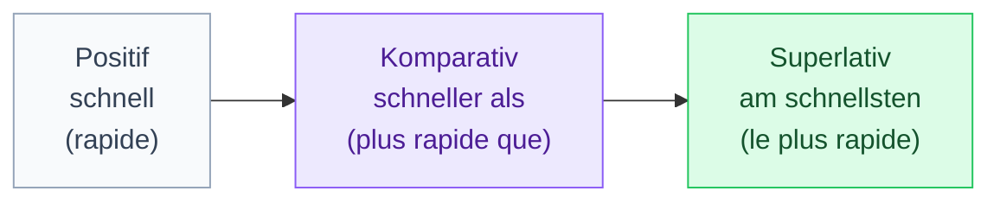

# 2. Le comparatif (Komparativ)

<mark style="color:blue;">**Pas de « plus » en allemand : on colle -er à l'adjectif, et on compare avec « als ».**</mark>

&#x20;


**En bref**

* **Comparatif** : adjectif + **-er** + **als** → *schnell → schnell**er** **als***.
* **Égalité** : **so** + adjectif + **wie** → ***so** schnell **wie***.
* **Superlatif** : **am** + adjectif + **-sten** → ***am** schnell**sten***.
* Beaucoup d'adjectifs courts prennent un **Umlaut** (*alt → **ä**lter*), et quelques-uns sont **irréguliers** (*gut → **besser***).


&#x20;

***

&#x20;

## <mark style="color:purple;">01</mark> · Les trois degrés de comparaison

&#x20;

&#x20;

| Degré           | Construction                | Exemple                                       | Français                                  |
| --------------- | --------------------------- | --------------------------------------------- | ----------------------------------------- |
| **Positif**     | adjectif tel quel           | Der Laptop ist **schnell**.                   | Le portable est rapide.                   |
| **Komparativ**  | adjectif + **-er** (+ als)  | Der Laptop ist **schneller als** der PC.      | Le portable est plus rapide que le PC.    |
| **Superlativ**  | **am** + adjectif + **-sten** | Der Server ist **am schnellsten**.          | Le serveur est le plus rapide.            |

&#x20;

***

&#x20;

## <mark style="color:purple;">02</mark> · Former le comparatif : -er

&#x20;

On ajoute simplement **-er** à la fin de l'adjectif.

&#x20;

| Adjectif     | Komparativ        | Français          |
| ------------ | ----------------- | ----------------- |
| schnell      | schnell**er**     | plus rapide       |
| langsam      | langsam**er**     | plus lent         |
| einfach      | einfach**er**     | plus simple       |
| sicher       | sicher**er**      | plus sûr          |
| billig       | billig**er**      | moins cher        |
| klein        | klein**er**       | plus petit        |
| modern       | modern**er**      | plus moderne      |
| interessant  | interessant**er** | plus intéressant  |
| kompliziert  | kompliziert**er** | plus compliqué    |

&#x20;


**Différence avec le français et l'anglais**

* En français, on ajoute un mot : « **plus** rapide ».
* En anglais, les adjectifs longs prennent « **more** » : *more interesting*.
* En allemand, **même les adjectifs longs** prennent **-er** : *interessant**er***, *kompliziert**er***. On ne dit **jamais** ~~mehr interessant~~ ni ~~mehr schnell~~.


&#x20;

***

&#x20;

## <mark style="color:purple;">03</mark> · Comparer : als ou wie ?

&#x20;



### Différence → **als**

&#x20;

Comparatif (**-er**) + **als** = « plus … **que** »

&#x20;

* Python ist **einfacher als** C.
* Mein Passwort ist **sicherer als** deins.
* Eine SSD ist **schneller als** eine Festplatte.
* Er ist **älter als** ich.



### Égalité → **wie**

&#x20;

**so** + adjectif normal + **wie** = « aussi … **que** »

&#x20;

* Java ist **so** schwer **wie** C++.
* Der neue PC ist **genauso** schnell **wie** der alte. (*exactement aussi*)
* Mein Laptop ist **nicht so** teuer **wie** deiner. (*pas aussi … que*)



&#x20;


**L'erreur la plus fréquente** — mélanger les deux :

* <mark style="color:red;">~~schneller wie~~</mark> → <mark style="color:green;">schneller **als**</mark> (il y a un -er → **als**)
* <mark style="color:red;">~~so schnell als~~</mark> → <mark style="color:green;">so schnell **wie**</mark> (il y a un **so** → **wie**)

Astuce : **différence → -er … als** ; **égalité → so … wie**. Si tu vois un *-er*, c'est *als* ; si tu vois *so*, c'est *wie*.


&#x20;

Après **als** et **wie**, le pronom reste au **nominatif** (comme le sujet) : *Er ist größer als **ich*** (pas ~~mich~~), *Sie programmiert so gut wie **du***.

&#x20;

***

&#x20;

## <mark style="color:purple;">04</mark> · L'Umlaut : a, o, u → ä, ö, ü

&#x20;

Beaucoup d'adjectifs **courts** (une syllabe) avec **a, o** ou **u** prennent un **Umlaut** au comparatif et au superlatif.

&#x20;

| Adjectif | Komparativ        | Superlativ            | Français        |
| -------- | ----------------- | --------------------- | --------------- |
| alt      | **ä**lter         | am **ä**ltesten       | vieux           |
| jung     | j**ü**nger        | am j**ü**ngsten       | jeune           |
| groß     | gr**ö**ßer        | am gr**ö**ßten        | grand           |
| lang     | l**ä**nger        | am l**ä**ngsten       | long            |
| kurz     | k**ü**rzer        | am k**ü**rzesten      | court           |
| stark    | st**ä**rker       | am st**ä**rksten      | fort, puissant  |
| schwach  | schw**ä**cher     | am schw**ä**chsten    | faible          |
| warm     | w**ä**rmer        | am w**ä**rmsten       | chaud           |
| kalt     | k**ä**lter        | am k**ä**ltesten      | froid           |
| hart     | h**ä**rter        | am h**ä**rtesten      | dur             |
| oft      | **ö**fter         | am **ö**ftesten       | souvent         |

&#x20;


**Pas tous !** Certains adjectifs courts **ne prennent pas** d'Umlaut : *klar → klarer*, *laut → lauter*, *toll → toller*, *voll → voller*. Et les adjectifs **longs** n'en prennent jamais : *langsam → langsamer*. En cas de doute, apprends l'adjectif **avec** son comparatif, comme un verbe irrégulier.


&#x20;

***

&#x20;

## <mark style="color:purple;">05</mark> · Les petits changements d'orthographe

&#x20;

| Cas                                         | Règle                         | Exemples                                             |
| ------------------------------------------- | ----------------------------- | ---------------------------------------------------- |
| adjectif en **-el**                         | le **e** de -el tombe          | dunkel → dunk**l**er · flexibel → flexib**l**er      |
| adjectif en **-er**                         | le **e** de -er tombe souvent  | teuer → teu**r**er · sauer → sau**r**er              |
| **hoch**                                    | le **c** disparaît             | hoch → **höher** → am **höchsten**                   |
| superlatif après **-d, -t, -s, -ß, -z, -sch** | on ajoute **-e-** : **-esten** | alt → am ält**esten** · kurz → am kürz**esten** · heiß → am heiß**esten** · schlecht → am schlecht**esten** · interessant → am interessant**esten** |

&#x20;

**Pourquoi ce -e- en plus ?** Pour la **prononciation** : « am kürzsten » serait presque imprononçable (z + s + t). Le petit *e* ajoute une syllabe qui facilite la prononciation. (Exception : *groß → am größten*.)

&#x20;

***

&#x20;

## <mark style="color:purple;">06</mark> · Les irréguliers à connaître par cœur

&#x20;

| Positif  | Komparativ     | Superlativ          | Français                         |
| -------- | -------------- | ------------------- | -------------------------------- |
| **gut**  | **besser**     | am **besten**       | bon / bien → meilleur / mieux    |
| **viel** | **mehr**       | am **meisten**      | beaucoup → plus                  |
| **gern** | **lieber**     | am **liebsten**     | volontiers → préférer            |
| **hoch** | **höher**      | am **höchsten**     | haut                             |
| **nah**  | **näher**      | am **nächsten**     | proche                           |
| **groß** | **größer**     | am **größten**      | grand                            |

&#x20;



* Die neue Version ist **besser als** die alte.
* Sie programmiert **am besten** in unserem Team.

&#x20;

Ne dis jamais ~~guter~~ : comme en français où l'on dit « meilleur » et pas « plus bon ».



* Ich arbeite **mehr als** du. — Je travaille plus que toi.
* Dieser Server hat **mehr** Speicher. — Ce serveur a plus de mémoire.

&#x20;

**mehr ne change jamais** : *mehr Speicher, mehr Daten, mehr Zeit* (pas de terminaison).



*gern* + verbe = « aimer faire ». Son comparatif exprime la **préférence** :

&#x20;

* Ich programmiere **gern** in Python. — J'aime programmer en Python.
* Ich programmiere **lieber** in Java. — Je préfère programmer en Java.
* Ich programmiere **am liebsten** in C#. — Ce que je préfère, c'est programmer en C#.



&#x20;

***

&#x20;

## <mark style="color:purple;">07</mark> · Le superlatif : am … -sten ou der … -ste ?

&#x20;

Il y a **deux formes** selon la place dans la phrase :

&#x20;



### Après le verbe : **am -sten**

&#x20;

L'adjectif est **seul**, sans nom après lui (souvent après *sein*).

&#x20;

* Dieser Laptop ist **am schnellsten**.
* Wer arbeitet **am meisten**?
* Im Winter ist es **am kältesten**.



### Devant un nom : **der/die/das -ste**

&#x20;

L'adjectif est **collé à un nom**, il prend un article et une terminaison.

&#x20;

* Das ist **der schnellste** Laptop.
* Sie ist **die beste** Informatikerin.
* Das ist **das größte** Problem.



&#x20;

***

&#x20;

## <mark style="color:purple;">08</mark> · Le comparatif devant un nom (pour aller plus loin)

&#x20;

Devant un nom, le comparatif garde son **-er** **et** prend en plus la **terminaison normale** de l'adjectif :

&#x20;

| Cas          | Masculin                            | Féminin                       | Neutre                            |
| ------------ | ----------------------------------- | ----------------------------- | --------------------------------- |
| Nominatif    | ein schnell**er**er Computer        | eine schnell**er**e Lösung    | ein schnell**er**es Netzwerk      |
| Accusatif    | einen schnell**er**en Computer      | eine schnell**er**e Lösung    | ein schnell**er**es Netzwerk      |

&#x20;

* Ich brauche **einen besseren** Laptop. — J'ai besoin d'un meilleur portable.
* Wir suchen **eine einfachere** Lösung. — Nous cherchons une solution plus simple.

&#x20;


**Ne pas confondre** — dans *schnell**er**er*, le premier *-er* est celui du **comparatif**, le second est la **terminaison** de l'adjectif (masculin nominatif après *ein*). Les deux sont nécessaires.


&#x20;

***

&#x20;

## <mark style="color:purple;">09</mark> · Où mettre « als » dans la phrase ?

&#x20;

Rappelle-toi la **parenthèse** de la [page 1](01-place-du-verbe-et-questions.md) : le 2e morceau du verbe va à la fin. La comparaison avec **als** ou **wie** se place en général **après** cette parenthèse, tout à la fin :

&#x20;

| Position 1 | **Verbe 1** | Milieu         | **Verbe 2**        | Comparaison          |
| ---------- | ----------- | -------------- | ------------------ | -------------------- |
| Ich        | **habe**    | heute mehr     | **gearbeitet**     | **als du**.          |
| Er         | **kann**    | besser         | **programmieren**  | **als ich**.         |
| Wir        | **müssen**  | schneller      | **arbeiten**       | **als letztes Jahr**. |

&#x20;

C'est plus naturel que de couper la parenthèse : *Ich habe heute mehr gearbeitet **als du*** plutôt que ~~Ich habe heute mehr als du gearbeitet~~ (possible, mais lourd).

&#x20;

***

&#x20;

## <mark style="color:purple;">10</mark> · Expressions utiles

&#x20;

| Expression                          | Sens                    | Exemple                                              |
| ----------------------------------- | ----------------------- | ---------------------------------------------------- |
| **viel** + comparatif               | beaucoup plus           | Die SSD ist **viel schneller**.                      |
| **noch** + comparatif               | encore plus             | Die neue Version ist **noch besser**.                |
| **etwas** / **ein bisschen** + comparatif | un peu plus       | Der Laptop ist **etwas teurer**.                     |
| **immer** + comparatif              | de plus en plus         | Die Computer werden **immer schneller**.             |
| **je** … **desto** …                | plus … plus …           | **Je mehr** ich übe, **desto besser** spreche ich.   |

&#x20;


**Je … desto : attention à l'ordre des mots**

* Après **je**, le verbe conjugué va **à la fin** : *Je mehr ich **übe**, …*
* Après **desto** + comparatif, le verbe revient en **position 2** et passe avant le sujet : *… desto besser **spreche** ich.*

En français : « Plus je m'entraîne, mieux je parle. »


&#x20;

***

&#x20;

## <mark style="color:purple;">11</mark> · Exercices

&#x20;

### A. Donne le comparatif et le superlatif

&#x20;

1. klein · billig · sicher

&#x20;

**kleiner, am kleinsten · billiger, am billigsten · sicherer, am sichersten**

&#x20;

2. alt · jung · kurz

&#x20;

**älter, am ältesten · jünger, am jüngsten · kürzer, am kürzesten** (Umlaut + -esten après t et z)

&#x20;

3. gut · viel · gern

&#x20;

**besser, am besten · mehr, am meisten · lieber, am liebsten** (irréguliers)

&#x20;

4. teuer · dunkel · hoch

&#x20;

**teurer, am teuersten · dunkler, am dunkelsten · höher, am höchsten**

&#x20;

&#x20;

### B. als ou wie ?

&#x20;

5. Mein Computer ist schneller ___ deiner.

&#x20;

**als** — comparatif en -er.

&#x20;

6. Die Prüfung war so schwer ___ letztes Jahr.

&#x20;

**wie** — égalité avec *so*.

&#x20;

7. Er arbeitet genauso viel ___ ich.

&#x20;

**wie** — *genauso* = égalité.

&#x20;

8. Java ist komplizierter ___ Python.

&#x20;

**als**

&#x20;

&#x20;

### C. Traduis

&#x20;

9. Le nouveau portable est plus léger que l'ancien. (leicht)

&#x20;

**Der neue Laptop ist leichter als der alte.**

&#x20;

10. Mon mot de passe est aussi sûr que le tien.

&#x20;

**Mein Passwort ist so sicher wie deins.**

&#x20;

11. C'est le meilleur programme.

&#x20;

**Das ist das beste Programm.**

&#x20;

12. Je préfère travailler à la maison. (gern)

&#x20;

**Ich arbeite lieber zu Hause.**

&#x20;

13. Les réseaux deviennent de plus en plus rapides.

&#x20;

**Die Netzwerke werden immer schneller.**

&#x20;

&#x20;

### D. Trouve l'erreur

&#x20;

14. « Python ist mehr einfach als C. »

&#x20;

Correct : **Python ist einfacher als C.** — pas de *mehr* : on ajoute -er.

&#x20;

15. « Die neue Version ist guter als die alte. »

&#x20;

Correct : **Die neue Version ist besser als die alte.** — *gut* est irrégulier.

&#x20;

16. « Er ist älter wie ich. »

&#x20;

Correct : **Er ist älter als ich.** — après un comparatif : *als*.

&#x20;

17. « Dieser Server ist der schnellste. Er ist schnellste. »

&#x20;

Correct : **Er ist am schnellsten.** — sans nom après l'adjectif, on utilise *am … -sten*.

&#x20;

&#x20;

***

&#x20;

## <mark style="color:purple;">12</mark> · À retenir

&#x20;

* Comparatif = adjectif + **-er** + **als**, même pour les adjectifs longs (jamais *mehr* + adjectif).
* Égalité = **so** + adjectif + **wie**.
* Superlatif = **am -sten** (seul) ou **der/die/das -ste** (devant un nom) ; **-esten** après d, t, s, ß, z.
* Adjectifs courts avec a, o, u : souvent un <mark style="color:blue;">**Umlaut**</mark> (*älter, größer, jünger*).
* Irréguliers : **gut – besser – am besten**, **viel – mehr – am meisten**, **gern – lieber – am liebsten**, **hoch – höher – am höchsten**.
* La comparaison avec *als* se met en général **après** la parenthèse verbale.

&#x20;


**Page précédente** → [1. Place du verbe et questions](01-place-du-verbe-et-questions.md) · **Retour au sommaire** → [Allemand](../allemand.md)

