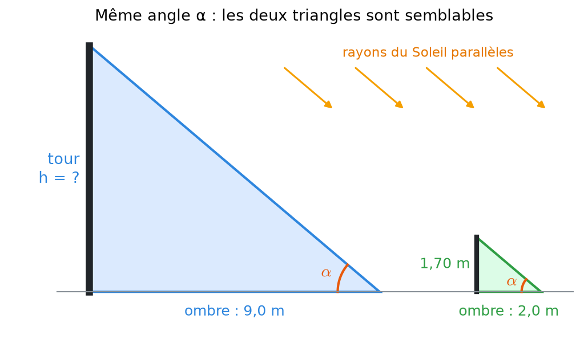
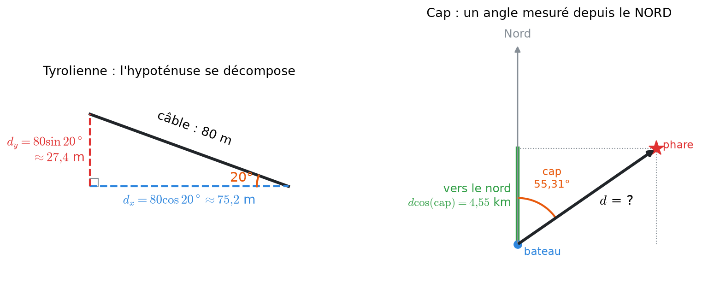
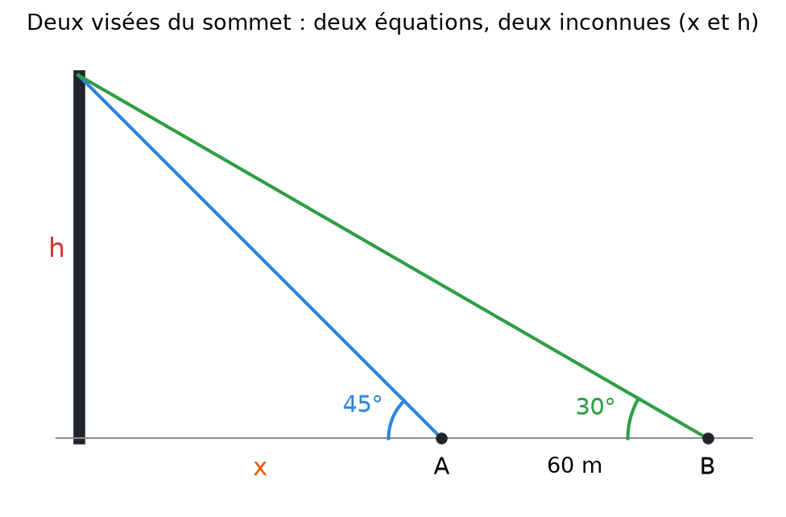
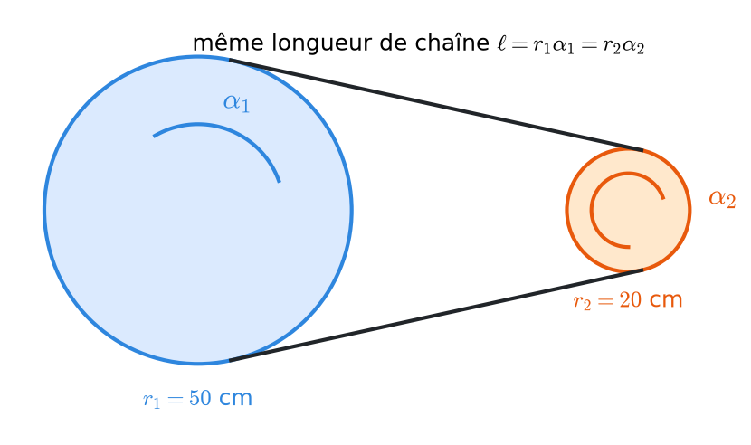
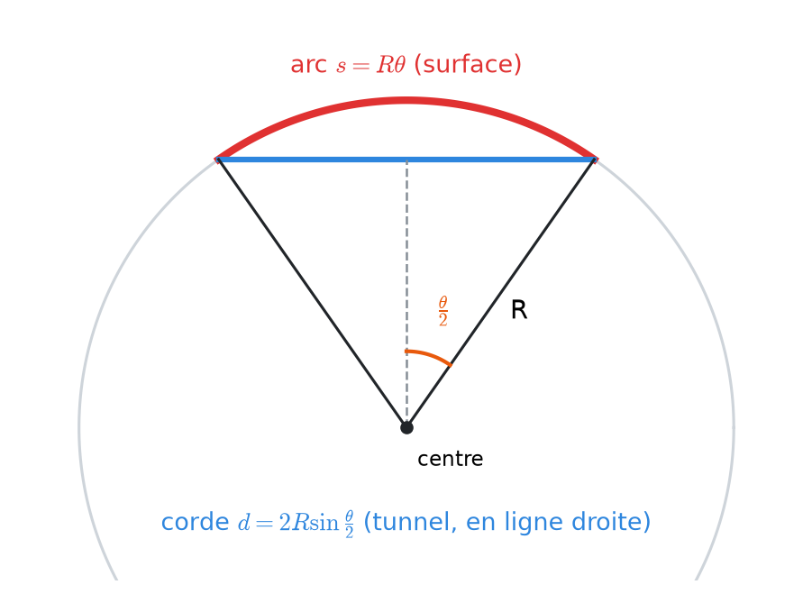

# 1 bis. Triangles et angles en situation

<mark style="color:blue;">**Les outils du chapitre 1 appliqués à des problèmes concrets : mesurer une tour avec son ombre, localiser un phare, calculer un tunnel.**</mark>

&#x20;


**En bref**

Presque tous les problèmes concrets se ramènent à **dessiner un triangle**, puis à choisir le bon outil :

* un triangle **rectangle** → SOH-CAH-TOA ;
* deux triangles avec **les mêmes angles** → ils sont **semblables** : les côtés sont **proportionnels** ;
* un triangle **quelconque** → loi des cosinus / loi des sinus ;
* un morceau de **cercle** → arc $$\ell = r\alpha$$, secteur $$A = \frac{1}{2}r^2\alpha$$, corde $$d = 2r\sin\frac{\alpha}{2}$$.

Cette page complète [1. Angles, triangles et mouvements circulaires](01-angles-et-triangles.md) avec les notions et exercices des séries 1 et 2.


&#x20;

***

&#x20;

## <mark style="color:purple;">01</mark> · Un triangle est-il « déterminé » ? La triangulation

&#x20;

### La somme des angles

&#x20;

Dans **tout** triangle, les trois angles additionnés font **180°** (= π rad).

&#x20;

**Pourquoi ?** Trace une droite parallèle à un côté, passant par le sommet opposé. Les deux autres angles du triangle se retrouvent « recopiés » de part et d'autre du troisième (angles alternes-internes). Ensemble, les trois angles forment une **ligne droite** : 180°.

&#x20;

### Les critères : quand connaît-on « tout » le triangle ?

&#x20;

On dit qu'un triangle est **déterminé** quand les données ne permettent de construire **qu'un seul** triangle (au déplacement près : on peut le tourner, le retourner, le déplacer, mais sa forme et sa taille sont fixées). Trois critères garantissent ça :

&#x20;

| Critère | On connaît…                                               | Lettres                    |
| ------- | --------------------------------------------------------- | -------------------------- |
| **CCC** | les **3 côtés**                                           | Côté-Côté-Côté             |
| **CAC** | **2 côtés** et l'**angle entre eux**                      | Côté-Angle-Côté            |
| **ACA** | **1 côté** et les **2 angles qui le touchent**            | Angle-Côté-Angle           |

&#x20;


**Ce qui ne suffit pas** — connaître les **3 angles** ne fixe pas la taille (un petit et un grand triangle peuvent avoir les mêmes angles). Et « 2 côtés + un angle qui n'est **pas** entre eux » peut donner **deux** triangles : c'est le cas ambigu de la loi des sinus ([chapitre 1](01-angles-et-triangles.md)).


&#x20;

### Exemple : laser tag (la triangulation)

&#x20;

Deux joueurs A et B, séparés de **12 m**, visent un adversaire C. Ils mesurent les angles **α = 40°** (en A) et **β = 65°** (en B).

&#x20;

<mark style="color:orange;">1.</mark> Troisième angle : $$\gamma = 180° - 40° - 65° = 75°$$.

<mark style="color:orange;">2.</mark> On connaît un côté (AB) et les **deux angles qui le touchent** : c'est le critère **ACA**. Le triangle est déterminé : du côté indiqué de la droite (AB), la position de C est **unique**.

&#x20;

C'est le principe de la **triangulation**, utilisé depuis l'Antiquité par les arpenteurs et les astronomes : avec une base connue et deux directions, on localise un point inaccessible.

&#x20;

***

&#x20;

## <mark style="color:purple;">02</mark> · Degrés, minutes, secondes

&#x20;

En navigation et en astronomie, on écrit souvent les angles en **degrés, minutes, secondes** (système **sexagésimal**, en base 60, hérité de la Mésopotamie) :

$$1° = 60' \qquad 1' = 60'' \qquad\text{donc}\qquad 1' = \frac{1}{60}° \qquad 1'' = \frac{1}{3600}°$$

&#x20;

C'est **exactement comme les heures** : 1 h = 60 min, 1 min = 60 s. « 2 h 30 » vaut 2,5 h, et de même 2°30' vaut 2,5°.

&#x20;

### Conversion : DMS → degrés décimaux → radians

&#x20;

**Exemple :** la latitude d'un phare est $$\varphi = 36°32'48''$$.

&#x20;

<mark style="color:orange;">1. En degrés décimaux</mark> : on divise les minutes par 60, les secondes par 3600, et on additionne.

$$36°32'48'' = 36 + \frac{32}{60} + \frac{48}{3600} = 36 + 0{,}5333 + 0{,}0133 \approx 36{,}547°$$

<mark style="color:orange;">2. En radians</mark> : on multiplie par $$\frac{\pi}{180}$$.

$$36{,}547 \times \frac{\pi}{180} \approx 0{,}638 \text{ rad}$$

&#x20;

### Le chemin inverse : décimal → DMS

&#x20;

**Exemple :** 55,31°.

* Degrés : la partie entière, **55°**.
* Minutes : $$0{,}31 \times 60 = 18{,}6$$ → **18'** (on garde la partie entière).
* Secondes : $$0{,}6 \times 60 = 36$$ → **36''**.

Donc $$55{,}31° = 55°18'36''$$.

&#x20;


**Piège** — 36°32' n'est **pas** 36,32° ! Les minutes sont des **soixantièmes**, pas des centièmes. $$32' = \frac{32}{60}° \approx 0{,}533°$$.


&#x20;

***

&#x20;

## <mark style="color:purple;">03</mark> · Conversions degrés ↔ radians : la méthode pour tout

&#x20;

Rappel : $$\pi \text{ rad} = 180°$$, donc

$$\alpha_{\text{rad}} = \alpha_{\text{deg}} \cdot \frac{\pi}{180} \qquad\qquad \alpha_{\text{deg}} = \alpha_{\text{rad}} \cdot \frac{180}{\pi}$$

&#x20;

**Méthode sans calculatrice :** on écrit la fraction et on la **simplifie**.

* $$150° = \frac{150}{180}\pi = \frac{5}{6}\pi = \frac{5\pi}{6}$$ (on a divisé 150 et 180 par 30).
* $$\frac{11\pi}{4} = \frac{11}{4} \cdot 180° = 11 \cdot 45° = 495°$$ (un quart de 180 vaut 45).

&#x20;

### Le tableau de la série 1 (exercice 1)

&#x20;

| Degrés  | 150°               | −60°               | 225°              | 120°              | −135°              | 210°              | 450°              | 72°               | 100°              | 54°                |
| ------- | ------------------ | ------------------ | ----------------- | ----------------- | ------------------ | ----------------- | ----------------- | ----------------- | ----------------- | ------------------ |
| Radians | $$\frac{5\pi}{6}$$ | $$-\frac{\pi}{3}$$ | $$\frac{5\pi}{4}$$ | $$\frac{2\pi}{3}$$ | $$-\frac{3\pi}{4}$$ | $$\frac{7\pi}{6}$$ | $$\frac{5\pi}{2}$$ | $$\frac{2\pi}{5}$$ | $$\frac{5\pi}{9}$$ | $$\frac{3\pi}{10}$$ |

&#x20;

| Radians | $$-\frac{2\pi}{3}$$ | $$\frac{11\pi}{6}$$ | $$\frac{3\pi}{4}$$ | $$\frac{\pi}{10}$$ | $$\frac{4\pi}{3}$$ | $$\frac{11\pi}{4}$$ | $$-\frac{7\pi}{2}$$ | $$\frac{\pi}{9}$$ | $$-\frac{5\pi}{2}$$ | $$9\pi$$ |
| ------- | ------------------- | ------------------- | ------------------ | ------------------ | ------------------ | ------------------- | ------------------- | ----------------- | ------------------- | -------- |
| Degrés  | −120°               | 330°                | 135°               | 18°                | 240°               | 495°                | −630°               | 20°               | −450°               | 1620°    |

&#x20;


**Angles négatifs ou plus grands que 360°** — ils sont parfaitement valables : un angle **négatif** tourne dans le sens des aiguilles d'une montre, un angle **> 360°** fait plus d'un tour. 450° = 360° + 90° : un tour complet, puis un quart de tour. La conversion se fait exactement de la même façon.


&#x20;

***

&#x20;

## <mark style="color:purple;">04</mark> · Triangles semblables : mesurer avec une ombre

&#x20;

Deux triangles sont **semblables** s'ils ont **les mêmes angles**. L'un est alors un **agrandissement** de l'autre : tous les côtés sont multipliés par le même nombre. Leurs côtés sont donc **proportionnels**.

&#x20;

### Exemple : mission secrète au château de Gruyères

&#x20;

L'ombre de la tour mesure **9,0 m**. Au même moment, une étudiante de **1,70 m** a une ombre de **2,0 m**. Quelle est la hauteur h de la tour ?

&#x20;

<figure><figcaption>
Le Soleil est si loin que ses rayons arrivent parallèles : la tour et l'étudiante sont éclairées sous le même angle α.
</figcaption></figure>

&#x20;

**Pourquoi les triangles sont-ils semblables ?** Les deux ont un **angle droit** (tour et étudiante sont verticales) et le **même angle α** avec le sol (rayons parallèles). Deux angles égaux → le troisième aussi (somme = 180°) → mêmes angles.

&#x20;

<mark style="color:orange;">1. Proportion</mark> (hauteur / ombre identique dans les deux triangles) :

$$\frac{h}{9{,}0} = \frac{1{,}70}{2{,}0} \quad\Longrightarrow\quad h = 9{,}0 \cdot \frac{1{,}70}{2{,}0} = 7{,}65 \text{ m}$$

&#x20;

<mark style="color:orange;">2. Une heure plus tard</mark>, l'ombre de la tour mesure 7,2 m. Le rapport hauteur / ombre a changé (le Soleil a bougé), mais il est **le même** pour la tour et l'étudiante :

$$\frac{7{,}65}{7{,}2} = \frac{1{,}70}{x} \quad\Longrightarrow\quad x = \frac{1{,}70 \cdot 7{,}2}{7{,}65} = 1{,}60 \text{ m}$$

&#x20;

<mark style="color:orange;">3. Et si on mesure mal ?</mark> La formule est $$h = 1{,}70 \cdot \frac{L_{\text{tour}}}{L_{\text{étudiante}}}$$. Avec une erreur possible de 5 cm sur chaque ombre :

* h est **le plus grand** quand le numérateur est grand et le dénominateur petit : $$h_{\max} = 1{,}70 \cdot \frac{9{,}05}{1{,}95} \approx 7{,}89 \text{ m}$$ ;
* h est **le plus petit** dans le cas inverse : $$h_{\min} = 1{,}70 \cdot \frac{8{,}95}{2{,}05} \approx 7{,}42 \text{ m}$$.

Une petite erreur de 5 cm donne presque **50 cm** d'incertitude sur la tour : l'erreur sur la petite ombre (2 m) est **amplifiée** par le rapport.

&#x20;

***

&#x20;

## <mark style="color:purple;">05</mark> · Décomposer une longueur : composantes et caps

&#x20;

Une longueur **inclinée** (un câble, un déplacement en diagonale) peut toujours se **décomposer** en un morceau **horizontal** et un morceau **vertical**. C'est SOH-CAH-TOA, avec l'hypoténuse connue :

$$\text{horizontal} = L\cos\alpha \qquad\qquad \text{vertical} = L\sin\alpha$$

(α = angle avec l'**horizontale**)

&#x20;

<figure><figcaption>
À gauche, angle mesuré depuis l'horizontale. À droite, un cap est mesuré depuis le nord : les rôles de sin et cos s'échangent.
</figcaption></figure>

&#x20;

### Exemple : la tyrolienne au-dessus de la Sarine

&#x20;

Un câble de **80 m** est incliné de **20°**. Le dénivelé ne doit pas dépasser 30 m.

* Distance horizontale : $$d_x = 80\cos 20° \approx 75{,}18$$ m.
* Dénivelé : $$d_y = 80\sin 20° \approx 27{,}36$$ m < 30 m : la condition est **respectée**.
* Si l'angle passe à 35° (même câble) : $$80\cos 35° \approx 65{,}53$$ m et $$80\sin 35° \approx 45{,}89$$ m. Plus d'angle = moins d'horizontal, plus de vertical : la tyrolienne est **plus pentue** (et dépasse 30 m).

&#x20;

### Exemple : un combat dans Dofus

&#x20;

Un personnage doit rejoindre une cible à **5 m** en ligne droite, dans une direction à **36,9°** de l'horizontale. Les déplacements en **diagonale sont interdits** et chaque case vaut 1 m.

* Horizontal : $$5\cos 36{,}9° \approx 4{,}00$$ m → 4 cases.
* Vertical : $$5\sin 36{,}9° \approx 3{,}00$$ m → 3 cases.

Sans diagonale, il faut parcourir les deux composantes l'une après l'autre : $$4 + 3 =$$ **7 cases = 7 PM**. (En ligne droite, ce serait seulement 5 : c'est le triangle 3-4-5.)

&#x20;

### Le cap : un angle mesuré depuis le nord

&#x20;

En navigation, un **cap** est mesuré **depuis le nord**, dans le sens des aiguilles d'une montre. L'angle est donc pris par rapport à la **verticale** de la carte, et non l'horizontale :

$$\text{composante vers le nord} = d\cos(\text{cap}) \qquad\qquad \text{composante vers l'est} = d\sin(\text{cap})$$

&#x20;

**Exemple : un phare dans le brouillard.** Le phare est au cap **55°18'36''** depuis le bateau, et **4,55 km plus au nord**. Quelle est la distance d ?

<mark style="color:orange;">1.</mark> $$55°18'36'' = 55 + \frac{18}{60} + \frac{36}{3600} = 55{,}31°$$.

<mark style="color:orange;">2.</mark> La composante nord est le côté **adjacent** au cap : $$d\cos(55{,}31°) = 4{,}55$$.

<mark style="color:orange;">3.</mark> $$d = \frac{4{,}55}{\cos(55{,}31°)} \approx 8{,}00$$ km.

&#x20;


**Réflexe** — avant d'écrire sin ou cos, **regarde depuis quel axe l'angle est mesuré**. Le côté **collé** à l'angle utilise **cos**, le côté **en face** utilise **sin**. Pas besoin d'apprendre deux règles : il suffit de faire le dessin.


&#x20;

***

&#x20;

## <mark style="color:purple;">06</mark> · Deux visées : quand on ne peut pas s'approcher

&#x20;

On veut la hauteur h d'une tour, mais on ne connaît **pas** la distance x jusqu'à son pied. On mesure l'angle sous lequel on voit le sommet depuis **deux points** A et B, séparés d'une distance connue.

&#x20;

<figure><figcaption>
Deux triangles rectangles partagent la même hauteur h : deux équations pour deux inconnues.
</figcaption></figure>

&#x20;

### Exemple : une grue pour restaurer la tour

&#x20;

Depuis A, on voit le sommet sous **45°** ; depuis B, **60 m** plus loin, sous **30°**.

&#x20;



### Une équation par visée

Dans chaque triangle rectangle, $$\tan(\text{angle}) = \frac{\text{opposé}}{\text{adjacent}} = \frac{h}{\text{distance}}$$ :

* depuis A : $$\tan 45° = \frac{h}{x} \Longrightarrow h = x$$ (car $$\tan 45° = 1$$) ;
* depuis B : $$\tan 30° = \frac{h}{x + 60} \Longrightarrow h = \frac{x + 60}{\sqrt{3}}$$ (car $$\tan 30° = \frac{1}{\sqrt{3}}$$).



### Égaler les deux expressions de h

C'est la **même** tour : $$x = \frac{x + 60}{\sqrt{3}} \iff \sqrt{3}\,x = x + 60 \iff x(\sqrt{3} - 1) = 60$$.



### Résoudre

$$x = \frac{60}{\sqrt{3} - 1} = \frac{60(\sqrt{3} + 1)}{(\sqrt{3} - 1)(\sqrt{3} + 1)} = \frac{60(\sqrt{3} + 1)}{2} = 30(\sqrt{3} + 1)$$

(on a multiplié en haut et en bas par $$\sqrt{3} + 1$$ pour enlever la racine du dénominateur.)



### Conclure

$$h = x = 30(\sqrt{3} + 1) \approx 81{,}96$$ m. La tour mesure environ **82 m**.



&#x20;


**La même idée sert partout** : deux observations → deux équations → on élimine l'inconnue gênante. Voir aussi la méthode D du [chapitre 3](03-fonctions-trigonometriques-reciproques.md) (problème de l'avion) et l'exercice de la montgolfière ci-dessous.


&#x20;

***

&#x20;

## <mark style="color:purple;">07</mark> · Arcs et secteurs en situation

&#x20;

Rappel (angle **en radians**) : arc $$\ell = r\alpha$$, secteur $$A = \frac{1}{2}r^2\alpha$$.

&#x20;



Noé coupe une part de **40°** dans une tarte de rayon **18 cm**. Léa veut **la même quantité** dans une tarte de rayon **12 cm**. Quel angle β doit-elle couper ?

&#x20;

<mark style="color:orange;">1.</mark> $$40° = \frac{40\pi}{180} = \frac{2\pi}{9}$$, donc $$A_N = \frac{1}{2} \cdot 18^2 \cdot \frac{2\pi}{9} = 36\pi \text{ cm}^2$$.

<mark style="color:orange;">2.</mark> $$A_L = \frac{1}{2} \cdot 12^2 \cdot \beta = 72\beta$$.

<mark style="color:orange;">3.</mark> $$72\beta = 36\pi \Longrightarrow \beta = \frac{\pi}{2} = 90°$$ : **un quart** de la petite tarte.

&#x20;

**Pourquoi un angle plus grand ?** L'aire dépend de $$r^2$$ : la petite tarte est « moins épaisse en surface », il faut une part plus ouverte.



Vers −240, Ératosthène constate qu'à midi, le Soleil fait un angle de **7°12'** à Alexandrie, alors qu'il est à la verticale à Syène, **787,5 km** plus au sud. Cet angle est aussi l'**angle au centre** de la Terre entre les deux villes.

&#x20;

<mark style="color:orange;">1.</mark> $$7°12' = 7 + \frac{12}{60} = 7{,}2°$$.

<mark style="color:orange;">2.</mark> Fraction du tour : $$\frac{7{,}2}{360} = \frac{1}{50}$$.

<mark style="color:orange;">3.</mark> L'arc de 787,5 km est donc $$\frac{1}{50}$$ de la circonférence : $$C = 50 \cdot 787{,}5 = 39\,375$$ km.

<mark style="color:orange;">4.</mark> Rayon : $$R = \frac{C}{2\pi} \approx 6267$$ km (valeur moderne : 6371 km, seulement 1,6 % d'écart, il y a 2200 ans !).

&#x20;

**L'idée clé** : un arc est la **même fraction** du cercle que son angle est une fraction de 360°.



Un robot balaie un angle de **150°** avec un laser de portée **12 m**, et fait **600 mesures** réparties uniformément.

&#x20;

<mark style="color:orange;">1.</mark> $$150° = \frac{5\pi}{6}$$ rad. Arc : $$\ell = 12 \cdot \frac{5\pi}{6} = 10\pi \approx 31{,}42$$ m.

<mark style="color:orange;">2.</mark> Secteur : $$A = \frac{1}{2} \cdot 144 \cdot \frac{5\pi}{6} = 60\pi \approx 188{,}5 \text{ m}^2$$.

<mark style="color:orange;">3.</mark> Écart entre deux mesures : $$\Delta\theta = \frac{150°}{600} = 0{,}25° = \frac{\pi}{720}$$ rad.

<mark style="color:orange;">4.</mark> À 12 m, deux impacts voisins sont séparés de $$\Delta s = r\,\Delta\theta = 12 \cdot \frac{\pi}{720} \approx 5{,}24$$ cm.

<mark style="color:orange;">5.</mark> Si le rayon **double** : l'arc est multiplié par **2** ($$\ell = r\alpha$$), mais l'aire par **4** ($$A = \frac{1}{2}r^2\alpha$$, et $$2^2 = 4$$).



Une chaîne relie deux roues de diamètres **100 cm** et **40 cm**. La grande roue tourne de **100 rad**. De combien tourne la petite ?

&#x20;

<figure><figcaption>
La chaîne ne s'étire pas : elle fait parcourir le même arc aux deux roues.
</figcaption></figure>

&#x20;

<mark style="color:orange;">1.</mark> Rayons : $$r_1 = 50$$ cm, $$r_2 = 20$$ cm (attention : diamètre ÷ 2 !).

<mark style="color:orange;">2.</mark> Longueur de chaîne déroulée : $$\ell = r_1\alpha_1 = 50 \cdot 100 = 5000$$ cm.

<mark style="color:orange;">3.</mark> La petite roue parcourt **le même arc** : $$\alpha_2 = \frac{\ell}{r_2} = \frac{5000}{20} = 250$$ rad.

&#x20;

**Pourquoi le même arc ?** Chaque maillon de la chaîne qui passe sur la grande roue passe aussi sur la petite. Ce qui est commun, c'est la **longueur** (donc la vitesse linéaire), pas l'angle : la petite roue tourne **plus** (250 contre 100), d'un facteur $$\frac{r_1}{r_2} = 2{,}5$$. C'est le principe d'un dérailleur de vélo.



&#x20;

***

&#x20;

## <mark style="color:purple;">08</mark> · Arc ou corde ?

&#x20;

Entre deux points d'un cercle, il y a deux « distances » :

* l'**arc** : le chemin **le long du cercle**, $$s = R\theta$$ ;
* la **corde** : le segment **en ligne droite**, $$d = 2R\sin\frac{\theta}{2}$$.

&#x20;

<figure><figcaption>
En coupant le triangle isocèle en deux, on obtient deux triangles rectangles d'angle θ/2.
</figcaption></figure>

&#x20;

**D'où vient la formule de la corde ?** Le triangle (centre, extrémité 1, extrémité 2) est **isocèle** (deux côtés R). Sa hauteur le coupe en deux triangles rectangles d'angle $$\frac{\theta}{2}$$ et d'hypoténuse R. La demi-corde est le côté **opposé** : $$\frac{d}{2} = R\sin\frac{\theta}{2}$$.

&#x20;

### Exemple : le raccourci des neutrinos

&#x20;

Deux laboratoires sont distants de **732 km** à la surface de la Terre (R = 6378 km). Des neutrinos voyagent en **ligne droite** à travers la roche. Quelle distance parcourent-ils ?

<mark style="color:orange;">1.</mark> Angle au centre : $$\theta = \frac{s}{R} = \frac{732}{6378} \approx 0{,}11477$$ rad.

<mark style="color:orange;">2.</mark> Corde : $$d = 2 \cdot 6378 \cdot \sin\left(\frac{0{,}11477}{2}\right) \approx 731{,}60$$ km.

<mark style="color:orange;">3.</mark> Le tunnel naturel est plus court d'environ **400 m** : pour un petit angle, arc et corde sont très proches.

&#x20;

***

&#x20;

## <mark style="color:purple;">09</mark> · Exercices supplémentaires

&#x20;

### Exercice 1 — Le vinyle du DJ

&#x20;

Un disque tourne à **33,33 tours/min** ; chaque morceau occupe **100 tours**. a) Durée d'un morceau ? b) Longueur de sillon pour un morceau à r = 14 cm et à r = 6,5 cm ? c) Vitesse angulaire et vitesse linéaire aux deux rayons ?

&#x20;

Cliquez pour voir l'indice

&#x20;

Un tour = un périmètre $$2\pi r$$. Pour les vitesses : $$\omega = 2\pi f$$ (f en tours **par seconde**) et $$v = \omega r$$ (r en mètres).

&#x20;

Solution détaillée

&#x20;

<mark style="color:orange;">a)</mark> $$t = \frac{100}{33{,}33} \approx 3{,}0$$ min = 180 s.

<mark style="color:orange;">b)</mark> $$L = 100 \cdot 2\pi r$$ : à 14 cm, $$2800\pi \text{ cm} \approx 87{,}96$$ m ; à 6,5 cm, $$1300\pi \text{ cm} \approx 40{,}84$$ m.

<mark style="color:orange;">c)</mark> $$f = \frac{33{,}33}{60} \approx 0{,}5555$$ tour/s, donc $$\omega = 2\pi f \approx 3{,}490$$ rad/s, **la même partout** sur le disque. Mais $$v = \omega r$$ : $$v \approx 3{,}490 \cdot 0{,}14 \approx 0{,}489$$ m/s au bord et $$\approx 0{,}227$$ m/s près du centre.

**À retenir :** tout le disque tourne du même angle (même ω), mais un point du bord parcourt un plus grand cercle, donc va plus vite (plus grand v).

&#x20;

&#x20;

### Exercice 2 — Une passe de trop ?

&#x20;

Dans le triangle ABC : AB = 18 m, BC = 16 m, $$\widehat{B} = 120°$$. Calculer AC et l'angle $$\widehat{A}$$.

&#x20;

Cliquez pour voir l'indice

&#x20;

L'angle connu est **entre** les deux côtés connus (CAC) : loi des cosinus pour AC, puis loi des sinus pour $$\widehat{A}$$.

&#x20;

Solution détaillée

&#x20;

<mark style="color:orange;">1. Loi des cosinus :</mark>

$$AC^2 = 18^2 + 16^2 - 2 \cdot 18 \cdot 16 \cos 120° = 324 + 256 + 288 = 868$$

(car $$\cos 120° = -\frac{1}{2}$$, donc « − 2·18·16·(−½) » devient « + 288 ».)

$$AC = \sqrt{868} = 2\sqrt{217} \approx 29{,}46 \text{ m}$$

<mark style="color:orange;">2. Loi des sinus :</mark>

$$\frac{\sin\widehat{A}}{BC} = \frac{\sin\widehat{B}}{AC} \Longrightarrow \sin\widehat{A} = \frac{16\sin 120°}{2\sqrt{217}} = \frac{4\sqrt{3}}{\sqrt{217}}$$

<mark style="color:orange;">3. Pas d'ambiguïté :</mark> $$\widehat{B} = 120°$$ est obtus, donc les deux autres angles sont **aigus** (leur somme fait 60°). On peut prendre arcsin sans crainte :

$$\widehat{A} = \arcsin\left(\frac{4\sqrt{3}}{\sqrt{217}}\right) \approx 28{,}05°$$

&#x20;

&#x20;

### Exercice 3 — Deux minutes sous la montgolfière

&#x20;

Une observatrice est à une distance horizontale d du point de décollage. À 8 h 00, elle voit la montgolfière sous **30°** ; à 8 h 02, sous **60°**. Le ballon monte à **1,5 m/s**. Trouver d, les deux altitudes, et l'heure à laquelle il atteint **450 m**.

&#x20;

Cliquez pour voir l'indice

&#x20;

En 2 min, le ballon monte de $$1{,}5 \cdot 120 = 180$$ m. Écris $$\tan 30° = \frac{z_0}{d}$$ et $$\tan 60° = \frac{z_2}{d}$$, puis soustrais.

&#x20;

Solution détaillée

&#x20;

<mark style="color:orange;">1.</mark> $$z_0 = d\tan 30° = \frac{d}{\sqrt{3}}$$ et $$z_2 = d\tan 60° = \sqrt{3}\,d$$.

<mark style="color:orange;">2.</mark> $$z_2 - z_0 = 180 \iff \sqrt{3}\,d - \frac{d}{\sqrt{3}} = \frac{3d - d}{\sqrt{3}} = \frac{2d}{\sqrt{3}} = 180 \iff d = 90\sqrt{3} \approx 155{,}9$$ m.

<mark style="color:orange;">3.</mark> $$z_0 = \frac{90\sqrt{3}}{\sqrt{3}} = 90$$ m et $$z_2 = \sqrt{3} \cdot 90\sqrt{3} = 270$$ m.

<mark style="color:orange;">4.</mark> Depuis 8 h 00, il reste $$450 - 90 = 360$$ m à monter : $$\frac{360}{1{,}5} = 240$$ s = 4 min. Le ballon atteint 450 m à **8 h 04**.

&#x20;

&#x20;

### Exercice 4 — Conversions

&#x20;

Convertir **a)** 210° et 72° en radians ; **b)** $$-\frac{7\pi}{2}$$ et $$9\pi$$ en degrés ; **c)** 7°12' en degrés décimaux.

&#x20;

Solution

&#x20;

**a)** $$210° = \frac{210}{180}\pi = \frac{7\pi}{6}$$ ; $$72° = \frac{72}{180}\pi = \frac{2\pi}{5}$$.

**b)** $$-\frac{7\pi}{2} = -\frac{7}{2} \cdot 180° = -630°$$ ; $$9\pi = 9 \cdot 180° = 1620°$$.

**c)** $$7 + \frac{12}{60} = 7{,}2°$$.

&#x20;

&#x20;

***

&#x20;

## <mark style="color:purple;">10</mark> · À retenir

&#x20;

* Somme des angles = 180°. Triangle déterminé par **CCC**, **CAC** ou **ACA** (triangulation).
* DMS : $$1' = \frac{1}{60}°$$, $$1'' = \frac{1}{3600}°$$ (ce ne sont **pas** des centièmes).
* Mêmes angles → triangles **semblables** → côtés **proportionnels** (méthode des ombres).
* Composantes : côté **collé** à l'angle → **cos**, côté **en face** → **sin**. Un cap se mesure depuis le **nord**.
* Deux visées → deux équations en tan → on élimine la distance inconnue.
* Arc $$\ell = r\alpha$$ (× 2 si r double), secteur $$A = \frac{1}{2}r^2\alpha$$ (× 4 si r double), corde $$d = 2r\sin\frac{\alpha}{2}$$.
* Chaîne ou courroie : **même longueur** (même vitesse linéaire) sur les deux roues.

&#x20;


**Page suivante** → [2. Le cercle trigonométrique](02-cercle-trigonometrique.md)

