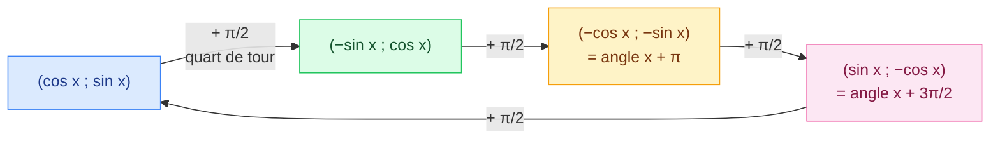

# 4 bis. Compléments : décalages, valeurs exactes, somme → produit

<mark style="color:blue;">**Les outils qui manquaient pour les séries 2 et 4 : comprendre les décalages au lieu de les apprendre, et transformer une somme de sinus en produit.**</mark>

&#x20;


**En bref**

* Ajouter $$\frac{\pi}{2}$$ à un angle, c'est **tourner le point d'un quart de tour** : $$(\cos x, \sin x)$$ devient $$(-\sin x, \cos x)$$. Tous les décalages se déduisent de cette seule image.
* Si on connaît **une** fonction (même sec, csc ou cot), un **triangle rectangle** donne toutes les autres.
* Les **formules d'addition** donnent des valeurs exactes comme $$\cos 75°$$.
* Les **formules somme → produit** transforment $$\sin a + \sin b$$ en un produit : indispensable pour les interférences et les battements ([6 bis](06b-modeliser-des-oscillations.md)).

Prérequis : [2. Le cercle trigonométrique](02-cercle-trigonometrique.md) et [4. Identités trigonométriques](04-identites-trigonometriques.md).


&#x20;

***

&#x20;

## <mark style="color:purple;">01</mark> · Les décalages : tout vient d'une rotation

&#x20;

Sur le cercle trigonométrique, l'angle x correspond au point $$M = (\cos x\,;\,\sin x)$$. Ajouter un angle à x, c'est **faire tourner** ce point autour du centre.

&#x20;

### La seule chose à comprendre : le quart de tour

&#x20;

Quand on fait tourner un point $$(a\,;\,b)$$ d'un **quart de tour** dans le sens positif (antihoraire), il arrive en $$(-b\,;\,a)$$.

&#x20;

**Vérifie avec un exemple** : le point $$(1\,;\,0)$$ (tout à droite) tourne d'un quart de tour et arrive en $$(0\,;\,1)$$ (tout en haut). La formule donne bien $$(-0\,;\,1)$$. Puis $$(0\,;\,1)$$ arrive en $$(-1\,;\,0)$$ (tout à gauche). La formule donne $$(-1\,;\,0)$$.

&#x20;

Appliqué à $$M = (\cos x\,;\,\sin x)$$, le point de l'angle $$x + \frac{\pi}{2}$$ est donc $$(-\sin x\,;\,\cos x)$$. En lisant ses deux coordonnées :

$$\Large \boxed{\cos\left(x + \tfrac{\pi}{2}\right) = -\sin x \qquad \sin\left(x + \tfrac{\pi}{2}\right) = \cos x}$$

&#x20;

### Tous les autres décalages en découlent

&#x20;

&#x20;

| Décalage        | Point obtenu                | Donc                                                          |
| --------------- | --------------------------- | ------------------------------------------------------------- |
| $$x + \frac{\pi}{2}$$  | $$(-\sin x\,;\,\cos x)$$    | $$\cos(x + \frac{\pi}{2}) = -\sin x$$, $$\sin(x + \frac{\pi}{2}) = \cos x$$ |
| $$x + \pi$$     | $$(-\cos x\,;\,-\sin x)$$   | $$\cos(x + \pi) = -\cos x$$, $$\sin(x + \pi) = -\sin x$$      |
| $$x + \frac{3\pi}{2}$$ | $$(\sin x\,;\,-\cos x)$$    | $$\cos(x + \frac{3\pi}{2}) = \sin x$$, $$\sin(x + \frac{3\pi}{2}) = -\cos x$$ |
| $$x - \frac{\pi}{2}$$  | $$(\sin x\,;\,-\cos x)$$    | (même point que $$+\frac{3\pi}{2}$$, car $$-\frac{\pi}{2} + 2\pi = \frac{3\pi}{2}$$) |
| $$x - \frac{3\pi}{2}$$ | $$(-\sin x\,;\,\cos x)$$    | (même point que $$+\frac{\pi}{2}$$) : $$\sin(x - \frac{3\pi}{2}) = \cos x$$ |

&#x20;


**Méthode en 2 étapes pour n'importe quel décalage**

1. **Ajoute ou retire des tours complets** (2π) pour te ramener à $$+\frac{\pi}{2}$$, $$+\pi$$ ou $$+\frac{3\pi}{2}$$ : un tour ne change rien.
2. **Fais tourner** le point $$(\cos x\,;\,\sin x)$$ d'autant de quarts de tour.

Les décalages **« π − x »** et **« −x »** sont des **symétries** (miroirs), pas des rotations : voir le tableau du [chapitre 2](02-cercle-trigonometrique.md).


&#x20;

### Et la tangente ?

&#x20;

Il suffit de diviser sin par cos :

* $$\tan(x + \pi) = \frac{-\sin x}{-\cos x} = \tan x$$ → la tangente a une **période π** ;
* $$\tan\left(x + \frac{\pi}{2}\right) = \frac{\cos x}{-\sin x} = -\frac{1}{\tan x}$$ ;
* $$\tan(-x) = \frac{-\sin x}{\cos x} = -\tan x$$ et $$\tan(\pi - x) = \frac{\sin x}{-\cos x} = -\tan x$$.

&#x20;

### Exercice 1 de la série 2 : toutes les simplifications

&#x20;

| Expression                    | Résultat               | Raison                                       |
| ----------------------------- | ---------------------- | -------------------------------------------- |
| $$\sin(-\alpha)$$             | $$-\sin\alpha$$        | miroir horizontal : la hauteur change de signe |
| $$\cos(-\alpha)$$             | $$\cos\alpha$$         | miroir horizontal : l'abscisse ne change pas |
| $$\cos(\frac{\pi}{2} - \alpha)$$ | $$\sin\alpha$$      | miroir sur la diagonale y = x : on échange cos et sin |
| $$\sin(\alpha + \frac{\pi}{2})$$ | $$\cos\alpha$$      | quart de tour                                |
| $$\tan(-\alpha)$$             | $$-\tan\alpha$$        | sin change de signe, cos non                 |
| $$\tan(\pi - \alpha)$$        | $$-\tan\alpha$$        | cos change de signe, sin non                 |
| $$\sin(\pi - \alpha)$$        | $$\sin\alpha$$         | miroir vertical : même hauteur               |
| $$\tan(\alpha + \frac{\pi}{2})$$ | $$-\frac{1}{\tan\alpha}$$ | quart de tour : $$\frac{\cos\alpha}{-\sin\alpha}$$ |
| $$\cos(\alpha + \pi)$$        | $$-\cos\alpha$$        | demi-tour                                    |
| $$\tan(\alpha + \pi)$$        | $$\tan\alpha$$         | demi-tour : les deux signes changent         |
| $$\sin(\alpha - \frac{3\pi}{2})$$ | $$\cos\alpha$$     | $$-\frac{3\pi}{2} + 2\pi = +\frac{\pi}{2}$$  |
| $$\cos(\alpha + \frac{3\pi}{2})$$ | $$\sin\alpha$$     | trois quarts de tour                         |

&#x20;

Dans les égalités avec la tangente, on suppose bien sûr que les deux côtés sont **définis** (pas de division par 0).

&#x20;

***

&#x20;

## <mark style="color:purple;">02</mark> · Une seule valeur connue → toutes les autres

&#x20;

**Situation :** l'angle α est **aigu** (entre 0 et 90°) et on connaît **une seule** de ses fonctions trigonométriques. On veut sin, cos et tan.

&#x20;



### Se ramener à sin, cos ou tan

Si on donne une fonction « inverse », on la retourne : $$\csc\alpha = \frac{1}{\sin\alpha}$$, $$\sec\alpha = \frac{1}{\cos\alpha}$$, $$\cot\alpha = \frac{1}{\tan\alpha}$$.



### Dessiner un triangle rectangle

On lit la fraction comme un rapport de côtés : $$\sin = \frac{\text{opposé}}{\text{hypoténuse}}$$, etc.



### Trouver le 3e côté par Pythagore

$$\text{hyp}^2 = \text{opp}^2 + \text{adj}^2$$



### Lire toutes les fonctions

α aigu → toutes les valeurs sont **positives**. (Sinon, le signe vient du quadrant : [chapitre 2](02-cercle-trigonometrique.md), méthode B.)



&#x20;

### Exercice 2 de la série 2

&#x20;

| Cas | Donnée                     | On en déduit                 | Triangle (opp, adj, hyp) | sin α                  | cos α                  | tan α                   |
| --- | -------------------------- | ---------------------------- | ------------------------ | ---------------------- | ---------------------- | ----------------------- |
| a   | $$\sin\alpha = \frac{3}{5}$$ | —                          | 3, 4, 5                  | $$\frac{3}{5}$$        | $$\frac{4}{5}$$        | $$\frac{3}{4}$$         |
| b   | $$\cos\alpha = \frac{8}{17}$$ | —                         | 15, 8, 17                | $$\frac{15}{17}$$      | $$\frac{8}{17}$$       | $$\frac{15}{8}$$        |
| c   | $$\tan\alpha = \frac{5}{12}$$ | —                         | 5, 12, 13                | $$\frac{5}{13}$$       | $$\frac{12}{13}$$      | $$\frac{5}{12}$$        |
| d   | $$\cot\alpha = \frac{7}{24}$$ | $$\tan\alpha = \frac{24}{7}$$ | 24, 7, 25            | $$\frac{24}{25}$$      | $$\frac{7}{25}$$       | $$\frac{24}{7}$$        |
| e   | $$\sec\alpha = \frac{6}{5}$$  | $$\cos\alpha = \frac{5}{6}$$  | $$\sqrt{11}$$, 5, 6  | $$\frac{\sqrt{11}}{6}$$ | $$\frac{5}{6}$$       | $$\frac{\sqrt{11}}{5}$$ |
| f   | $$\csc\alpha = 4$$         | $$\sin\alpha = \frac{1}{4}$$ | 1, $$\sqrt{15}$$, 4      | $$\frac{1}{4}$$        | $$\frac{\sqrt{15}}{4}$$ | $$\frac{\sqrt{15}}{15}$$ |

&#x20;

**Détail du cas e :** $$\cos\alpha = \frac{5}{6}$$ → adjacent 5, hypoténuse 6 → opposé $$\sqrt{6^2 - 5^2} = \sqrt{11}$$.

**Détail du cas f :** $$\tan\alpha = \frac{1}{\sqrt{15}}$$. On **rationalise** (on enlève la racine du dénominateur) en multipliant en haut et en bas par $$\sqrt{15}$$ : $$\frac{\sqrt{15}}{15}$$.

&#x20;

***

&#x20;

## <mark style="color:purple;">03</mark> · Valeurs exactes grâce aux formules d'addition

&#x20;

75° n'est pas un angle remarquable, mais $$75° = 45° + 30°$$, et ces deux-là le sont. Les formules d'addition ([chapitre 4](04-identites-trigonometriques.md)) donnent la valeur **exacte** :

$$\cos 75° = \cos 45°\cos 30° - \sin 45°\sin 30° = \frac{\sqrt{2}}{2} \cdot \frac{\sqrt{3}}{2} - \frac{\sqrt{2}}{2} \cdot \frac{1}{2} = \frac{\sqrt{6} - \sqrt{2}}{4}$$

$$\sin 75° = \sin 45°\cos 30° + \cos 45°\sin 30° = \frac{\sqrt{6} + \sqrt{2}}{4}$$

&#x20;

### Exemple : le projecteur du planétarium

&#x20;

Un projecteur au centre d'une coupole de rayon **12 m** envoie un faisceau incliné de **75°** par rapport à l'horizontale. Puis le faisceau tourne de **30°**.

* Position horizontale du point éclairé : $$x = 12\cos 75° = 3(\sqrt{6} - \sqrt{2}) \approx 3{,}11$$ m.
* Hauteur : $$y = 12\sin 75° = 3(\sqrt{6} + \sqrt{2}) \approx 11{,}59$$ m.
* Chemin parcouru sur la coupole quand le faisceau tourne de $$30° = \frac{\pi}{6}$$ : c'est un **arc**, $$\ell = r\alpha = 12 \cdot \frac{\pi}{6} = 2\pi \approx 6{,}28$$ m.

&#x20;

### Exemple : le réglage d'hiver du refuge

&#x20;

Un panneau solaire de **2,20 m** est incliné de **50°**. Il est posé sur un toit incliné de **20°**. Quelle hauteur h doit avoir le support à son extrémité ?

&#x20;

<mark style="color:orange;">1.</mark> L'extrémité du panneau s'élève de $$L\sin 50°$$. Sur la même distance horizontale $$L\cos 50°$$, le toit s'élève de $$L\cos 50° \tan 20°$$.

<mark style="color:orange;">2.</mark> Le support comble la différence :

$$h = L\sin 50° - L\cos 50° \cdot \frac{\sin 20°}{\cos 20°} = L \cdot \frac{\sin 50°\cos 20° - \cos 50°\sin 20°}{\cos 20°}$$

<mark style="color:orange;">3.</mark> On reconnaît au numérateur la formule $$\sin(a - b) = \sin a\cos b - \cos a\sin b$$ :

$$h = L \cdot \frac{\sin(50° - 20°)}{\cos 20°} = 2{,}20 \cdot \frac{\sin 30°}{\cos 20°} \approx 1{,}17 \text{ m}$$

&#x20;


**Savoir « reconnaître » une formule** — l'expression $$\sin a\cos b - \cos a\sin b$$ revient très souvent. La remplacer par $$\sin(a - b)$$ simplifie énormément le calcul. Entraîne-toi à reconnaître les 4 formules d'addition **dans les deux sens**.


&#x20;

***

&#x20;

## <mark style="color:purple;">04</mark> · Formules somme → produit

&#x20;

### D'où viennent-elles ?

&#x20;

On écrit les deux formules d'addition pour $$p + q$$ et $$p - q$$ :

$$\sin(p + q) = \sin p\cos q + \cos p\sin q$$

$$\sin(p - q) = \sin p\cos q - \cos p\sin q$$

&#x20;

En les **additionnant**, les termes $$\cos p\sin q$$ s'annulent :

$$\sin(p + q) + \sin(p - q) = 2\sin p\cos q$$

&#x20;

On pose maintenant $$a = p + q$$ et $$b = p - q$$. Alors $$p = \frac{a + b}{2}$$ (la **moyenne**) et $$q = \frac{a - b}{2}$$ (la **demi-différence**) :

$$\Large \boxed{\sin a + \sin b = 2\sin\left(\frac{a + b}{2}\right)\cos\left(\frac{a - b}{2}\right)}$$

&#x20;

### Les quatre formules

&#x20;

| Somme / différence  | Produit                                                                 |
| ------------------- | ----------------------------------------------------------------------- |
| $$\sin a + \sin b$$ | $$2\sin\frac{a + b}{2}\cos\frac{a - b}{2}$$                            |
| $$\sin a - \sin b$$ | $$2\cos\frac{a + b}{2}\sin\frac{a - b}{2}$$                            |
| $$\cos a + \cos b$$ | $$2\cos\frac{a + b}{2}\cos\frac{a - b}{2}$$                            |
| $$\cos a - \cos b$$ | $$-2\sin\frac{a + b}{2}\sin\frac{a - b}{2}$$                           |

&#x20;


**Pourquoi c'est utile ?** Une **somme** est difficile à étudier (où s'annule-t-elle ? quelle est son amplitude ?). Un **produit** est facile : il est nul dès qu'un facteur est nul, et on voit directement « une oscillation rapide multipliée par une amplitude lente ». C'est exactement ce qui explique les **interférences** et les **battements** ([6 bis](06b-modeliser-des-oscillations.md)).


&#x20;

**Exemple :** $$\sin(8\pi t) + \sin(12\pi t)$$. Moyenne des angles : $$\frac{8\pi t + 12\pi t}{2} = 10\pi t$$ ; demi-différence : $$\frac{8\pi t - 12\pi t}{2} = -2\pi t$$. Donc :

$$\sin(8\pi t) + \sin(12\pi t) = 2\sin(10\pi t)\cos(-2\pi t) = 2\cos(2\pi t)\sin(10\pi t)$$

(le cosinus est **pair** : $$\cos(-2\pi t) = \cos(2\pi t)$$.)

&#x20;

***

&#x20;

## <mark style="color:purple;">05</mark> · Une distance qui varie : le bras du robot

&#x20;

Un bras de longueur **b = 3 m** tourne autour d'un pivot situé **h = 2 m** au-dessus d'un point B, à la vitesse angulaire $$\omega = \frac{\pi}{12}$$ rad/s. Dans un repère d'origine B, l'extrémité A du bras est en :

$$A(t) = \big(b\cos(\omega t)\,;\; h + b\sin(\omega t)\big)$$

&#x20;

**Distance BA** (Pythagore avec les coordonnées) :

$$D(t) = \sqrt{b^2\cos^2(\omega t) + h^2 + 2hb\sin(\omega t) + b^2\sin^2(\omega t)}$$

On regroupe $$b^2\cos^2 + b^2\sin^2 = b^2(\cos^2 + \sin^2) = b^2$$ (identité fondamentale) :

$$D(t) = \sqrt{h^2 + b^2 + 2hb\sin(\omega t)}$$

&#x20;

* $$D(0) = \sqrt{13} \approx 3{,}61$$ m ; $$D(3) = \sqrt{13 + 6\sqrt{2}} \approx 4{,}64$$ m ; $$D(6) = \sqrt{25} = 5$$ m.
* Comme $$-1 \leq \sin \leq 1$$ : $$\sqrt{h^2 + b^2 - 2hb} \leq D \leq \sqrt{h^2 + b^2 + 2hb}$$, c'est-à-dire $$|h - b| \leq D \leq h + b$$. Ici, **entre 1 m et 5 m**.

&#x20;

**Pourquoi ces bornes sont logiques :** la distance est maximale quand le bras pointe **à l'opposé** de B (les longueurs s'additionnent : 2 + 3), et minimale quand il pointe **vers** B (elles se soustraient : 3 − 2).

&#x20;

***

&#x20;

## <mark style="color:purple;">06</mark> · Exercices

&#x20;

1. Simplifier cos(α − π/2) et sin(α + 3π/2)

&#x20;

* $$\cos(\alpha - \frac{\pi}{2})$$ : un quart de tour en arrière donne le point $$(\sin\alpha\,;\,-\cos\alpha)$$ → $$\sin\alpha$$.
* $$\sin(\alpha + \frac{3\pi}{2})$$ : trois quarts de tour donnent $$(\sin\alpha\,;\,-\cos\alpha)$$ → $$-\cos\alpha$$.

&#x20;

2. α aigu, csc α = 3. Calculer sin, cos, tan.

&#x20;

$$\sin\alpha = \frac{1}{3}$$ → opposé 1, hypoténuse 3 → adjacent $$\sqrt{9 - 1} = 2\sqrt{2}$$.

$$\cos\alpha = \frac{2\sqrt{2}}{3}$$, $$\tan\alpha = \frac{1}{2\sqrt{2}} = \frac{\sqrt{2}}{4}$$.

&#x20;

3. Valeur exacte de tan 15°

&#x20;

$$15° = 45° - 30°$$ :

$$\tan 15° = \frac{\tan 45° - \tan 30°}{1 + \tan 45°\tan 30°} = \frac{1 - \frac{1}{\sqrt{3}}}{1 + \frac{1}{\sqrt{3}}} = \frac{\sqrt{3} - 1}{\sqrt{3} + 1} = \frac{(\sqrt{3} - 1)^2}{2} = 2 - \sqrt{3}$$

&#x20;

4. Écrire cos(5t) + cos(3t) comme un produit

&#x20;

Moyenne : 4t, demi-différence : t → $$2\cos(4t)\cos(t)$$.

&#x20;

&#x20;

***

&#x20;

## <mark style="color:purple;">07</mark> · À retenir

&#x20;

* **Quart de tour** : $$(\cos x, \sin x) \to (-\sin x, \cos x)$$. Demi-tour : les deux changent de signe. Les tours complets ne changent rien.
* $$\tan(x + \pi) = \tan x$$, $$\tan(x + \frac{\pi}{2}) = -\frac{1}{\tan x}$$.
* Une valeur connue → **triangle rectangle + Pythagore** → toutes les autres (sec, csc, cot : on retourne d'abord la fraction).
* Formules d'addition → valeurs exactes ($$\cos 75° = \frac{\sqrt{6} - \sqrt{2}}{4}$$) ; savoir **reconnaître** $$\sin a\cos b - \cos a\sin b = \sin(a - b)$$.
* **Somme → produit** : $$\sin a + \sin b = 2\sin(\text{moyenne})\cos(\text{demi-différence})$$.

&#x20;


**Page suivante** → [5. Équations trigonométriques](05-equations-trigonometriques.md)

