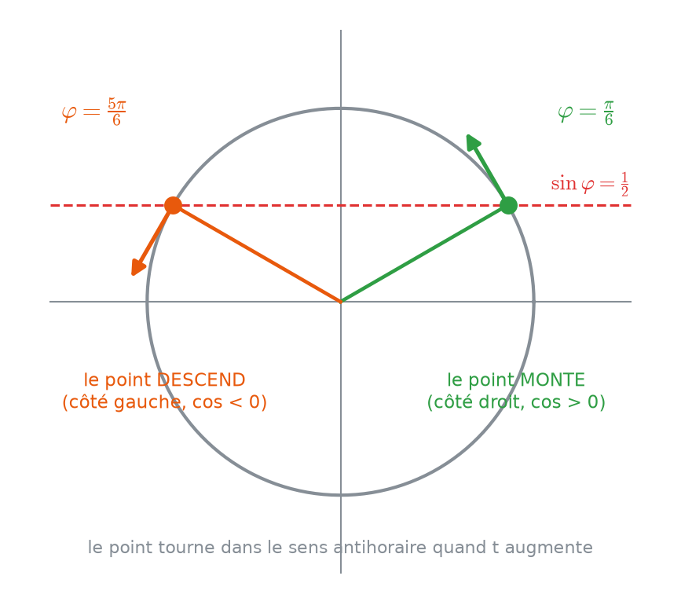
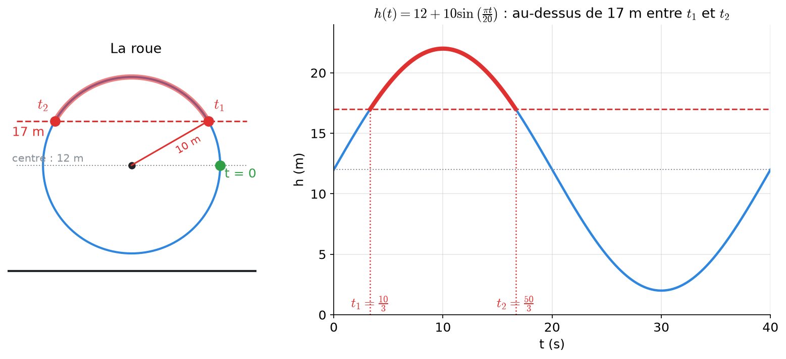
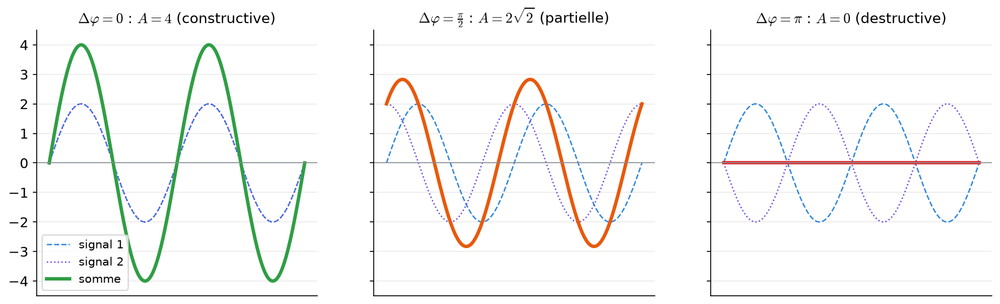
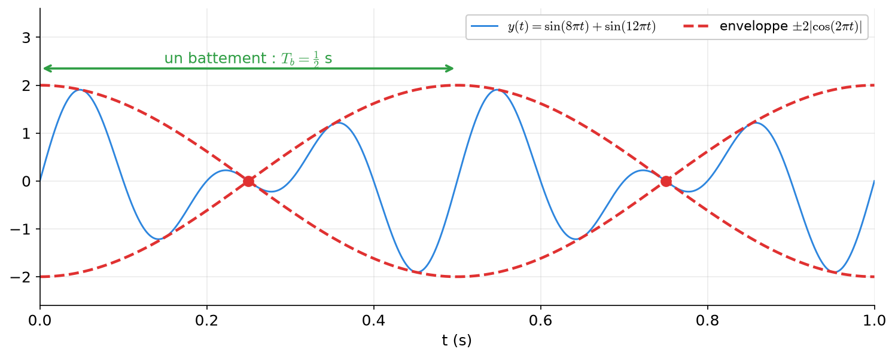

# 6 bis. Modéliser des oscillations

<mark style="color:blue;">**Un ressort, un pendule, une grande roue : tout ce qui se répète s'écrit avec un sinus. Ici, on apprend à écrire l'équation, puis à répondre aux questions « quand ? » et « combien de temps ? ».**</mark>

&#x20;


**En bref**

Le modèle complet d'une oscillation est :

$$y(t) = D + A\sin(\omega t + \varphi)$$

* **D** = la position du **milieu** (l'équilibre), **A** = l'**amplitude** (l'écart maximal au milieu) ;
* **ω** = la **pulsation**, liée à la période T par $$\omega = \frac{2\pi}{T}$$ ;
* **φ** = la **phase** : elle dit **où** on démarre et **dans quel sens** on part.

Pour trouver **quand** il se passe quelque chose, on résout une **équation** trigonométrique en t ; pour trouver **combien de temps**, une **inéquation**. Prérequis : [5](05-equations-trigonometriques.md), [5 bis](05b-inequations-trigonometriques.md) et [6. Oscillations et phaseurs](06-oscillations-harmoniques.md).


&#x20;

***

&#x20;

## <mark style="color:purple;">01</mark> · Le modèle et ses paramètres

&#x20;

| Paramètre | Nom          | Ce que c'est concrètement                           | Comment le trouver                         |
| --------- | ------------ | --------------------------------------------------- | ------------------------------------------ |
| **D**     | ligne médiane | la position d'équilibre, le centre de l'oscillation | $$\frac{\text{max} + \text{min}}{2}$$     |
| **A**     | amplitude    | l'écart entre le milieu et le maximum               | $$\frac{\text{max} - \text{min}}{2}$$     |
| **T**     | période      | la durée d'une oscillation complète (en s)          | donnée, ou lue sur le graphe              |
| **f**     | fréquence    | le nombre d'oscillations par seconde (en Hz)        | $$f = \frac{1}{T}$$                       |
| **ω**     | pulsation    | l'angle parcouru par seconde (en rad/s)             | $$\omega = 2\pi f = \frac{2\pi}{T}$$      |
| **φ**     | phase        | l'angle au départ (t = 0)                           | avec la position **et** le sens à t = 0   |

&#x20;

**Pourquoi $$\omega = \frac{2\pi}{T}$$ ?** Pendant une période T, l'angle à l'intérieur du sinus doit avancer d'**un tour complet** (2π). Donc $$\omega T = 2\pi$$.

&#x20;

**D'où vient le « D » ?** Le sinus seul oscille autour de **0**. Une nacelle de grande roue oscille autour de la hauteur du **centre** de la roue. On **décale** donc toute la courbe vers le haut de D.

&#x20;

***

&#x20;

## <mark style="color:purple;">02</mark> · Écrire l'équation à partir d'un énoncé

&#x20;



### Amplitude A et milieu D

Lis le maximum et le minimum (ou le rayon et la hauteur du centre pour une roue).



### Pulsation ω

À partir de la période, de la fréquence ou du nombre de tours : $$\omega = \frac{2\pi}{T} = 2\pi f$$.



### Sinus ou cosinus ?

* Départ **au milieu** → **sinus** est le plus simple ($$\sin 0 = 0$$).
* Départ **à un maximum** → **cosinus** est le plus simple ($$\cos 0 = 1$$).

Les deux sont justes, l'un des deux donne juste φ = 0.



### Phase φ : position ET sens

La position à t = 0 donne en général **deux** angles possibles. Le **sens** (monte ou descend) départage.



&#x20;

### Comment choisir φ avec le sens du mouvement

&#x20;

<figure><figcaption>
Deux angles ont le même sinus, mais sur le côté droit le point monte, sur le côté gauche il descend.
</figcaption></figure>

&#x20;

Quand t augmente, l'angle $$\omega t + \varphi$$ augmente : le point **tourne dans le sens antihoraire** sur le cercle, et y est sa **hauteur**.

* Si le point est sur la **moitié droite** du cercle ($$\cos\varphi > 0$$), en tournant il **monte** ;
* sur la **moitié gauche** ($$\cos\varphi < 0$$), il **descend**.

&#x20;


**Avec les dérivées** (même conclusion) — la vitesse est $$y'(t) = A\omega\cos(\omega t + \varphi)$$, donc $$y'(0) = A\omega\cos\varphi$$. « Ça monte » ⟺ $$y'(0) > 0$$ ⟺ $$\cos\varphi > 0$$.


&#x20;

### Exemple 1 : une masse suspendue à un ressort (série 4, ex. 3)

&#x20;

*La masse oscille entre −3 cm et 3 cm, fait 2 oscillations par seconde. À t = 0, elle est à 1,5 cm au-dessus de l'équilibre et **monte**.*

&#x20;

<mark style="color:orange;">1.</mark> **A = 3 cm**, **D = 0** (oscillation autour de l'équilibre).

<mark style="color:orange;">2.</mark> **f = 2 Hz** → $$T = \frac{1}{2}$$ s → $$\omega = 2\pi \cdot 2 = 4\pi$$ rad/s.

<mark style="color:orange;">3.</mark> À t = 0 : $$3\sin\varphi = 1{,}5 \iff \sin\varphi = \frac{1}{2} \iff \varphi = \frac{\pi}{6}$$ ou $$\varphi = \frac{5\pi}{6}$$.

<mark style="color:orange;">4.</mark> La masse **monte** → $$\cos\varphi > 0$$ → côté droit → $$\varphi = \frac{\pi}{6}$$.

$$\Large \color{#2F9E44} y(t) = 3\sin\left(4\pi t + \frac{\pi}{6}\right)$$

&#x20;

### Exemple 2 : un pendule (série 4, ex. 4)

&#x20;

*L'écart maximal est $$\frac{\pi}{12}$$ rad, la période **2 s**. À t = 0, le pendule est à l'extrémité **droite** (angle positif maximal).*

&#x20;

<mark style="color:orange;">1.</mark> $$A = \frac{\pi}{12}$$ rad, $$\omega = \frac{2\pi}{2} = \pi$$ rad/s.

<mark style="color:orange;">2.</mark> Départ **au maximum** → on choisit un **cosinus** : $$\theta(t) = A\cos(\omega t + \varphi)$$.

<mark style="color:orange;">3.</mark> $$\theta(0) = \frac{\pi}{12}\cos\varphi = \frac{\pi}{12} \iff \cos\varphi = 1 \iff \varphi = 0$$.

$$\Large \color{#2F9E44} \theta(t) = \frac{\pi}{12}\cos(\pi t)$$

&#x20;

### Exemple 3 : la grande roue (avec une ligne médiane)

&#x20;

*Une roue de rayon **10 m**, dont le centre est à **12 m** du sol, fait un tour en **40 s**. À t = 0, une nacelle est à la hauteur du centre et **monte**.*

&#x20;

<mark style="color:orange;">1.</mark> La hauteur oscille autour du centre : **D = 12 m**, avec une amplitude égale au rayon : **A = 10 m**.

<mark style="color:orange;">2.</mark> $$\omega = \frac{2\pi}{40} = \frac{\pi}{20}$$ rad/s.

<mark style="color:orange;">3.</mark> Départ au milieu en montant → sinus avec φ = 0 :

$$\Large \color{#2F9E44} h(t) = 12 + 10\sin\left(\frac{\pi t}{20}\right)$$

&#x20;

**Vérification :** $$h(0) = 12$$ (centre), le maximum est $$12 + 10 = 22$$ m (sommet de la roue), le minimum $$12 - 10 = 2$$ m (bas de la roue).

&#x20;

***

&#x20;

## <mark style="color:purple;">03</mark> · « À quels instants… ? » : une équation en t

&#x20;

### La méthode (et le point clé)

&#x20;



### Isoler le sinus (ou le cosinus)

On fait passer D et A de l'autre côté : on obtient $$\sin(\omega t + \varphi) = c$$.



### Poser u = ωt + φ et trouver l'intervalle de u

**C'est l'étape clé.** Si t varie dans un intervalle (par exemple une période), u varie aussi dans un intervalle, qu'on calcule **en remplaçant t par les bornes**. On cherche les solutions **dans cet intervalle de u**, et pas sur $$[0 ; 2\pi[$$ par réflexe.



### Résoudre en u, puis revenir à t

$$t = \frac{u - \varphi}{\omega}$$



&#x20;

### Exemple 1 : la grande roue à 17 m

&#x20;

$$12 + 10\sin\left(\frac{\pi t}{20}\right) = 17 \iff \sin\left(\frac{\pi t}{20}\right) = \frac{1}{2}$$

&#x20;

Pendant le premier tour, $$t \in [0 ; 40[$$, donc $$u = \frac{\pi t}{20} \in [0 ; 2\pi[$$. Dans cet intervalle, $$\sin u = \frac{1}{2}$$ pour $$u = \frac{\pi}{6}$$ et $$u = \frac{5\pi}{6}$$ :

$$\frac{\pi t_1}{20} = \frac{\pi}{6} \Longrightarrow t_1 = \frac{20}{6} = \frac{10}{3} \approx 3{,}3 \text{ s} \qquad \frac{\pi t_2}{20} = \frac{5\pi}{6} \Longrightarrow t_2 = \frac{50}{3} \approx 16{,}7 \text{ s}$$

&#x20;

<figure><figcaption>
La nacelle passe deux fois à 17 m pendant un tour : en montant (t₁) et en descendant (t₂).
</figcaption></figure>

&#x20;

### Exemple 2 : quand u fait plusieurs tours (le projecteur, série 3, ex. 9)

&#x20;

*Un projecteur tourne avec l'angle $$\theta(t) = \frac{\pi}{6}t$$. La fenêtre est éclairée quand $$\cos\theta = \frac{1}{2}$$. À quels instants entre 0 et 24 s ?*

&#x20;

<mark style="color:orange;">1. Intervalle de θ :</mark> $$t \in [0 ; 24] \Longrightarrow \theta \in [0 ; 4\pi]$$ : **deux tours** complets !

<mark style="color:orange;">2.</mark> $$\cos\theta = \frac{1}{2} \iff \theta = \pm\frac{\pi}{3} + 2k\pi$$. Dans $$[0 ; 4\pi]$$ : $$\frac{\pi}{3}, \frac{5\pi}{3}, \frac{7\pi}{3}, \frac{11\pi}{3}$$ (deux par tour).

<mark style="color:orange;">3.</mark> $$t = \frac{6\theta}{\pi}$$ : **t = 2 s, 10 s, 14 s, 22 s**.

&#x20;


**L'erreur classique** — chercher les solutions seulement dans $$[0 ; 2\pi[$$ « par habitude ». Ici, on aurait trouvé seulement 2 instants au lieu de 4. **Calcule toujours l'intervalle de u** à partir de celui de t.


&#x20;

### Exemple 3 : le ressort passe par l'équilibre (série 4, ex. 3 d)

&#x20;

$$y(t) = 3\sin\left(4\pi t + \frac{\pi}{6}\right) = 0 \iff 4\pi t + \frac{\pi}{6} = k\pi \iff t = \frac{k}{4} - \frac{1}{24}$$

Pendant la première période $$[0 ; \frac{1}{2}[$$, on teste les k : k = 0 donne $$-\frac{1}{24}$$ (trop tôt), k = 1 donne $$\frac{5}{24}$$, k = 2 donne $$\frac{11}{24}$$, k = 3 donne $$\frac{17}{24}$$ (trop tard). Réponse : $$t = \frac{5}{24}$$ s et $$t = \frac{11}{24}$$ s.

&#x20;

***

&#x20;

## <mark style="color:purple;">04</mark> · « Pendant combien de temps… ? » : une inéquation en t

&#x20;

On résout l'inéquation comme au [chapitre 5 bis](05b-inequations-trigonometriques.md), puis on **mesure la longueur** des intervalles de temps obtenus.

&#x20;



Au-dessus de 17 m : $$\sin u \geq \frac{1}{2}$$, c'est-à-dire $$u \in [\frac{\pi}{6} ; \frac{5\pi}{6}]$$ (arc du haut du cercle), soit $$t \in [t_1 ; t_2]$$.

&#x20;

Durée : $$t_2 - t_1 = \frac{50}{3} - \frac{10}{3} = \frac{40}{3} \approx 13{,}3$$ s.

&#x20;

**Contrôle :** l'arc du haut fait $$\frac{5\pi}{6} - \frac{\pi}{6} = \frac{2\pi}{3}$$, soit **un tiers** du tour. Un tiers de 40 s fait bien 13,3 s.



$$x(t) = 2\cos(4\pi t)$$ (mm). Quand est-on à plus de 1 mm de l'équilibre ?

&#x20;

$$|x(t)| \geq 1 \iff |\cos(4\pi t)| \geq \frac{1}{2}$$

&#x20;

Sur le cercle, $$|\cos u| \geq \frac{1}{2}$$ correspond aux deux arcs proches des extrémités gauche et droite : $$u \in [k\pi - \frac{\pi}{3} ; k\pi + \frac{\pi}{3}]$$. Avec $$u = 4\pi t$$ :

$$t \in \left[\frac{k}{4} - \frac{1}{12} \;;\; \frac{k}{4} + \frac{1}{12}\right]$$

&#x20;

Sur une période $$[0 ; \frac{1}{2}[$$ : $$[0 ; \frac{1}{12}] \cup [\frac{1}{6} ; \frac{1}{3}] \cup [\frac{5}{12} ; \frac{1}{2}[$$.

&#x20;

Durée totale : $$\frac{1}{12} + \frac{1}{6} + \frac{1}{12} = \frac{1}{3}$$ s, soit **les deux tiers** de la période ($$\frac{1}{2}$$ s).

&#x20;

Les instants exacts où $$|x| = 1$$ sont des **points isolés** : ils ne changent pas une durée. Le résultat est le même pour $$|x| > 1$$.



$$\theta(t) = \frac{\pi}{12}\cos(\pi t)$$. Quand l'écart est-il au moins la moitié de l'écart maximal, $$|\theta| \geq \frac{\pi}{24}$$ ?

&#x20;

$$\left|\frac{\pi}{12}\cos(\pi t)\right| \geq \frac{\pi}{24} \iff |\cos(\pi t)| \geq \frac{1}{2}$$

&#x20;

Sur une période $$t \in [0 ; 2[$$, $$u = \pi t \in [0 ; 2\pi[$$ : $$u \in [0 ; \frac{\pi}{3}] \cup [\frac{2\pi}{3} ; \frac{4\pi}{3}] \cup [\frac{5\pi}{3} ; 2\pi[$$, d'où

$$t \in \left[0 ; \tfrac{1}{3}\right] \cup \left[\tfrac{2}{3} ; \tfrac{4}{3}\right] \cup \left[\tfrac{5}{3} ; 2\right[$$

&#x20;

Le pendule est alors près de l'une de ses deux extrémités. (Il passe par la verticale, $$\cos(\pi t) = 0$$, en $$t = \frac{1}{2}$$ s et $$t = \frac{3}{2}$$ s.)



$$h(t) = 10 + 8\sin\left(\frac{\pi}{18}t\right)$$, $$t \in [0 ; 36]$$. Quand est-on à 14 m, et combien de temps au-dessus ?

&#x20;

$$10 + 8\sin\theta = 14 \iff \sin\theta = \frac{1}{2}$$ avec $$\theta = \frac{\pi}{18}t \in [0 ; 2\pi]$$ → $$\theta = \frac{\pi}{6}$$ ou $$\frac{5\pi}{6}$$ → **t = 3 s et t = 15 s**.

&#x20;

Entre les deux, le sinus dépasse 1/2 : au-dessus de 14 m pendant **15 − 3 = 12 s**.



&#x20;

***

&#x20;

## <mark style="color:purple;">05</mark> · Vitesse et accélération

&#x20;

La **vitesse** est la rapidité avec laquelle la position change ; mathématiquement, c'est la **dérivée** de la position. L'**accélération** est la dérivée de la vitesse. Pour un sinus, il suffit de connaître deux règles :

$$\big(\sin(\omega t + \varphi)\big)' = \omega\cos(\omega t + \varphi) \qquad \big(\cos(\omega t + \varphi)\big)' = -\omega\sin(\omega t + \varphi)$$

&#x20;

Pour $$y(t) = A\sin(\omega t + \varphi)$$ :

$$\Large v(t) = A\omega\cos(\omega t + \varphi) \qquad a(t) = -A\omega^2\sin(\omega t + \varphi) = -\omega^2\,y(t)$$

&#x20;

| Grandeur      | Valeur maximale         | Quand ?                                  |
| ------------- | ----------------------- | ---------------------------------------- |
| position      | $$A$$                   | aux extrémités                           |
| vitesse       | $$A\omega$$             | au passage par le **milieu**             |
| accélération  | $$A\omega^2$$           | aux **extrémités**                       |

&#x20;

**Pourquoi ?** Pense à une balançoire : au point le plus haut, elle s'arrête un instant pour repartir dans l'autre sens (**vitesse nulle**) ; c'est là qu'elle est le plus fortement « tirée » vers le milieu (**accélération maximale**). Au point le plus bas, elle va le plus vite.

&#x20;

### Exemple : série 4, exercice 6

&#x20;

$$y(t) = 4\sin\left(\pi t + \frac{\pi}{6}\right)$$ (cm).

* A = 4 cm, ω = π rad/s, T = 2 s, f = 0,5 Hz.
* $$v(t) = 4\pi\cos\left(\pi t + \frac{\pi}{6}\right)$$ et $$a(t) = -4\pi^2\sin\left(\pi t + \frac{\pi}{6}\right)$$.
* À t = 0 : $$y(0) = 4\sin\frac{\pi}{6} = 2$$ cm, $$v(0) = 4\pi\cos\frac{\pi}{6} = 2\sqrt{3}\,\pi$$ cm/s, $$a(0) = -4\pi^2 \cdot \frac{1}{2} = -2\pi^2$$ cm/s².
* Maximums : $$|v|_{\max} = 4\pi$$ cm/s, $$|a|_{\max} = 4\pi^2$$ cm/s².
* Vitesse nulle : $$\cos(\pi t + \frac{\pi}{6}) = 0 \iff \pi t + \frac{\pi}{6} = \frac{\pi}{2} + k\pi$$, donc sur $$[0 ; 2[$$ : $$t = \frac{1}{3}$$ s et $$t = \frac{4}{3}$$ s. On y trouve $$y = 4$$ et $$y = -4$$ : les **extrémités**.

&#x20;

***

&#x20;

## <mark style="color:purple;">06</mark> · Deux oscillations, une seule : a sin + b cos

&#x20;

**Exemple (série 4, ex. 7) :** $$y(t) = 3\sin(2t) + 4\cos(2t)$$. On cherche $$y(t) = A\sin(2t + \varphi)$$.

&#x20;

<mark style="color:orange;">1. Développer la forme cherchée</mark> avec la formule d'addition :

$$A\sin(2t + \varphi) = A\cos\varphi \cdot \sin(2t) + A\sin\varphi \cdot \cos(2t)$$

<mark style="color:orange;">2. Identifier</mark> les coefficients de $$\sin(2t)$$ et $$\cos(2t)$$ :

$$A\cos\varphi = 3 \qquad A\sin\varphi = 4$$

<mark style="color:orange;">3. Amplitude :</mark> on élève au carré et on additionne, et $$\cos^2 + \sin^2 = 1$$ :

$$A^2 = 3^2 + 4^2 = 25 \Longrightarrow A = 5$$

<mark style="color:orange;">4. Phase :</mark> $$\cos\varphi = \frac{3}{5} > 0$$ et $$\sin\varphi = \frac{4}{5} > 0$$ : premier quadrant, $$\varphi = \arctan\frac{4}{3}$$.

$$\Large \color{#2F9E44} y(t) = 5\sin\left(2t + \arctan\tfrac{4}{3}\right)$$

&#x20;

* Min et max : **−5 et 5** (car $$-1 \leq \sin \leq 1$$).
* Zéros : $$2t + \varphi = k\pi \iff t = \frac{k\pi - \varphi}{2}$$.

&#x20;


**C'est la même chose que les phaseurs** du [chapitre 6](06-oscillations-harmoniques.md) : le vecteur $$(A\cos\varphi\,;\,A\sin\varphi) = (3\,;\,4)$$, de longueur 5. L'identification est juste une autre façon de l'écrire. Attention au **quadrant** si un des deux coefficients est négatif.


&#x20;

***

&#x20;

## <mark style="color:purple;">07</mark> · Interférences : se renforcer ou s'annuler

&#x20;

Deux signaux **de même fréquence et même amplitude**, décalés de $$\Delta\varphi$$ :

$$y(t) = 2\sin(3t) + 2\sin(3t + \Delta\varphi)$$

&#x20;

Avec la formule somme → produit ([4 bis](04b-complements-identites.md)) :

$$y(t) = 4\cos\left(\frac{\Delta\varphi}{2}\right)\sin\left(3t + \frac{\Delta\varphi}{2}\right)$$

&#x20;

C'est une seule sinusoïde, d'amplitude $$A = 4\left|\cos\frac{\Delta\varphi}{2}\right|$$ : **tout dépend du décalage**.

&#x20;

<figure><figcaption>
En pointillés les deux signaux, en trait épais leur somme.
</figcaption></figure>

&#x20;

| Décalage $$\Delta\varphi$$ | Amplitude                          | Nom                          | Ce qui se passe                                  |
| -------------------------- | ---------------------------------- | ---------------------------- | ------------------------------------------------ |
| 0                          | $$4\cos 0 = 4$$                    | **constructive**             | les bosses tombent ensemble : elles s'additionnent |
| $$\frac{\pi}{2}$$          | $$4\cos\frac{\pi}{4} = 2\sqrt{2} \approx 2{,}83$$ | partiellement constructive | en partie ensemble, en partie non       |
| $$\pi$$                    | $$4\cos\frac{\pi}{2} = 0$$         | **destructive**              | une bosse tombe sur un creux : tout s'annule     |

&#x20;

C'est le principe des **casques anti-bruit** : ils produisent un son décalé de π qui annule le bruit extérieur.

&#x20;

***

&#x20;

## <mark style="color:purple;">08</mark> · Battements : deux fréquences proches

&#x20;

Deux diapasons de fréquences **4 Hz** et **6 Hz** sonnent ensemble :

$$y(t) = \sin(8\pi t) + \sin(12\pi t)$$

&#x20;

Somme → produit (moyenne $$10\pi t$$, demi-différence $$-2\pi t$$, cosinus pair) :

$$\Large y(t) = 2\cos(2\pi t)\,\sin(10\pi t)$$

&#x20;

<figure><figcaption>
Une oscillation rapide (5 Hz) dont l'amplitude monte et descend lentement (pointillés rouges : l'enveloppe).
</figcaption></figure>

&#x20;

* $$\sin(10\pi t)$$ : l'oscillation **rapide**, de fréquence **5 Hz** (la moyenne des deux).
* $$2\cos(2\pi t)$$ : une **amplitude qui varie lentement**. Comme une amplitude est positive, l'**enveloppe** visible est $$A_{\text{env}}(t) = 2|\cos(2\pi t)|$$.
* Le son devient fort, puis s'éteint, puis redevient fort : ce sont les **battements**. Leur fréquence est la **différence** des fréquences :

$$\Large f_b = |f_2 - f_1| = 6 - 4 = 2 \text{ Hz} \qquad T_b = \frac{1}{f_b} = \frac{1}{2} \text{ s}$$

* Sur $$[0 ; 1]$$ : enveloppe maximale en $$t = 0, \frac{1}{2}, 1$$ ($$|\cos| = 1$$), nulle en $$t = \frac{1}{4}, \frac{3}{4}$$ ($$\cos = 0$$). Deux battements par seconde.

&#x20;


**Pourquoi $$|f_2 - f_1|$$ et non la moitié ?** Le facteur $$\cos(2\pi t)$$ a une fréquence de 1 Hz, mais on entend l'**intensité**, qui dépend de $$|\cos|$$ : la valeur absolue « replie » les creux négatifs en bosses, ce qui **double** la fréquence perçue (2 Hz). Les musiciens accordent leur instrument en éliminant les battements : quand les fréquences sont égales, $$f_b = 0$$.


&#x20;

***

&#x20;

## <mark style="color:purple;">09</mark> · Exercices

&#x20;

### Exercice 1 — Synthèse : le ressort dépasse-t-il le seuil ? (série 4, ex. 10)

&#x20;

$$y(t) = 4\sin\left(\frac{\pi}{3}t + \frac{\pi}{6}\right)$$ (cm), $$0 \leq t < 6$$. a) Vérifier que [0 ; 6[ est une période. b) Quand y = 2 ? c) Quand y ≥ 2 ? d) Durée au-dessus de 2 cm ? e) Quand le déplacement est-il maximal ?

&#x20;

Cliquez pour voir l'indice

&#x20;

Pose $$u = \frac{\pi}{3}t + \frac{\pi}{6}$$ et calcule l'intervalle de u quand $$t \in [0 ; 6[$$ : ce n'est **pas** $$[0 ; 2\pi[$$.

&#x20;

Solution détaillée

&#x20;

<mark style="color:orange;">a)</mark> $$T = \frac{2\pi}{\pi/3} = 6$$ s : [0 ; 6[ est exactement une période.

<mark style="color:orange;">b)</mark> $$\sin u = \frac{1}{2}$$ avec $$u \in [\frac{\pi}{6} ; \frac{13\pi}{6}[$$ (on remplace t par 0 et par 6). Solutions : $$u = \frac{\pi}{6}$$ et $$u = \frac{5\pi}{6}$$ ($$\frac{13\pi}{6}$$ est exclu). Retour à t : $$t = 0$$ et $$\frac{\pi}{3}t = \frac{5\pi}{6} - \frac{\pi}{6} = \frac{2\pi}{3} \Rightarrow t = 2$$ s.

<mark style="color:orange;">c)</mark> $$\sin u \geq \frac{1}{2}$$ pour $$u \in [\frac{\pi}{6} ; \frac{5\pi}{6}]$$, donc **t ∈ [0 ; 2]**.

<mark style="color:orange;">d)</mark> Durée : **2 s**, soit $$\frac{2}{6} = \frac{T}{3}$$.

<mark style="color:orange;">e)</mark> Maximum quand $$u = \frac{\pi}{2}$$ : $$\frac{\pi}{3}t = \frac{\pi}{3} \Rightarrow$$ **t = 1 s**, avec $$y_{\max} = 4$$ cm. C'est bien au milieu de [0 ; 2] : la courbe est symétrique autour de son sommet.

&#x20;

&#x20;

### Exercice 2 — Le diapason (série 4, ex. 5 a et b)

&#x20;

$$x(t) = 2\cos(4\pi t)$$ (mm). Donner A, ω, T, f, puis les instants de passage par l'équilibre sur une période.

&#x20;

Solution détaillée

&#x20;

A = 2 mm, ω = 4π rad/s, $$T = \frac{2\pi}{4\pi} = \frac{1}{2}$$ s, f = 2 Hz.

$$\cos(4\pi t) = 0 \iff 4\pi t = \frac{\pi}{2} + k\pi \iff t = \frac{1}{8} + \frac{k}{4}$$ → sur $$[0 ; \frac{1}{2}[$$ : $$t = \frac{1}{8}$$ s et $$t = \frac{3}{8}$$ s.

&#x20;

&#x20;

### Exercice 3 — Interférence

&#x20;

Quelle est l'amplitude de $$2\sin(3t) + 2\sin\left(3t + \frac{2\pi}{3}\right)$$ ?

&#x20;

Solution

&#x20;

$$A = 4\left|\cos\frac{\Delta\varphi}{2}\right| = 4\cos\frac{\pi}{3} = 4 \cdot \frac{1}{2} = 2$$. Les deux signaux s'annulent en partie : on retrouve l'amplitude d'**un seul** signal.

&#x20;

&#x20;

***

&#x20;

## <mark style="color:purple;">10</mark> · À retenir

&#x20;

* Modèle : $$y(t) = D + A\sin(\omega t + \varphi)$$, avec $$\omega = \frac{2\pi}{T} = 2\pi f$$.
* Départ au milieu → **sin** ; départ au maximum → **cos**.
* Phase : la position donne deux angles ; le **sens** tranche (monte ⟺ $$\cos\varphi > 0$$).
* « Quand ? » → équation ; « combien de temps ? » → inéquation, puis longueur des intervalles. Toujours **calculer l'intervalle de u** à partir de celui de t.
* $$|v|_{\max} = A\omega$$ (au milieu), $$|a|_{\max} = A\omega^2$$ (aux extrémités), $$v = 0$$ aux extrémités.
* $$a\sin + b\cos = A\sin(\cdot + \varphi)$$ avec $$A = \sqrt{a^2 + b^2}$$.
* Interférences : $$A = 2A_0\left|\cos\frac{\Delta\varphi}{2}\right|$$. Battements : $$f_b = |f_2 - f_1|$$.

&#x20;


**Page suivante** → [7. Nombres complexes](07-nombres-complexes.md)

